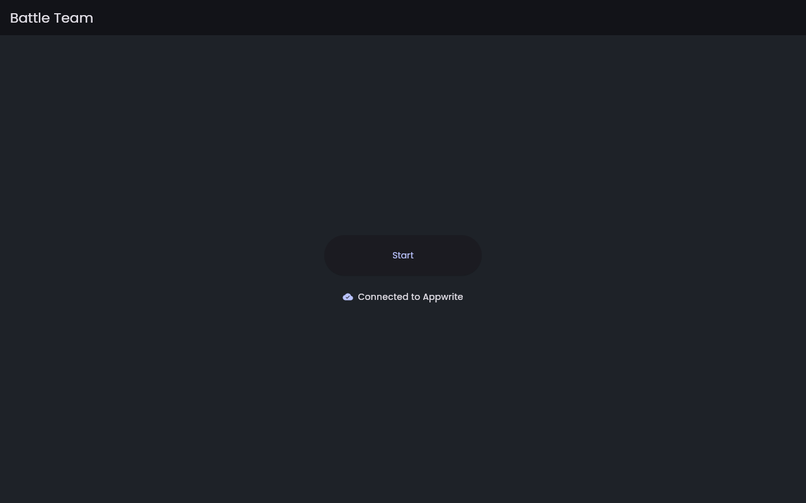
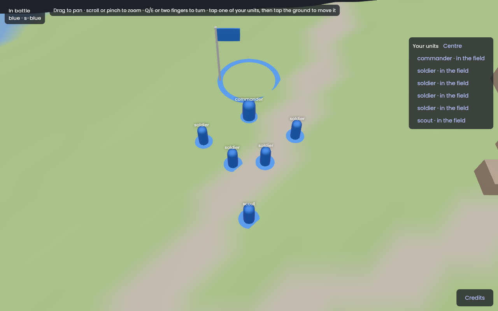
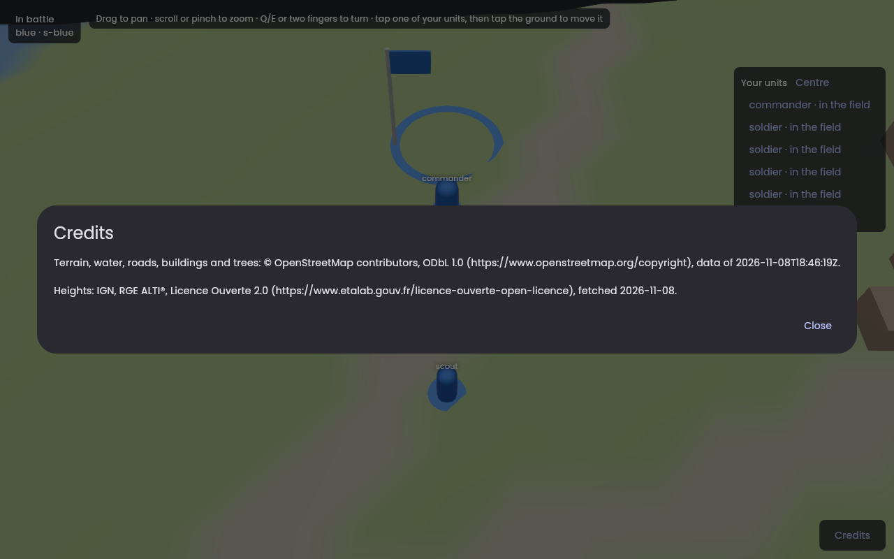
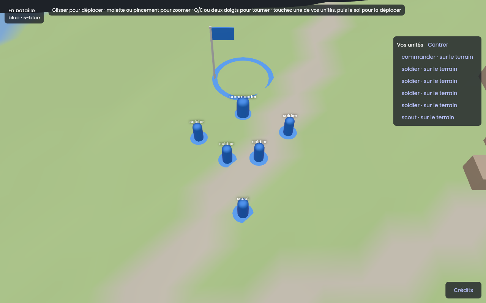

# Session M7.1: Normal launch, from the playtest

**Issue:** `apps/battle_team/plan/milestones/m7-client.md`, Issue 1. It is the specification of this session: read it entirely, with the milestone's "Conventions".
**Package:** `apps/battle_team` · **Branch:** `bt/m7-01-normal-launch` · **Depends on:** the playtest (merged); the plan PRs (see `agent-workflow.md` §6, last paragraph).
**Skills:** `vgv-ai-flutter-plugin:layered-architecture`, `vgv-ai-flutter-plugin:bloc`, `vgv-ai-flutter-plugin:testing`, `vgv-ai-flutter-plugin:internationalization`, `vgv-ai-flutter-plugin:green-gate`.
**Read** (`plan/` is `apps/battle_team/plan/`): `agent-workflow.md` §6; `docs/battle_team/playtest.md`; `plan/stack/04-client-and-rendering.md`; `plan/stack/07-engineering-principles.md`; the body of hawkbee1/battle_team#37 (the playtest PR); the whole of `apps/battle_team/lib/` and `test/` before changing anything.

## What exists
- `lib/playtest/`: `PlaytestCubit` (+ state) on `battle_client`; `PlaytestWorld` (interface), `BattleWorld` (flutter_scene, `coverage:ignore-file`), `TopDownCamera`, `battle_space.dart`; `PlaytestApp`, `PlaytestPage`, `PlaytestView`; `PlaytestSettings.fromEnvironment()` (sign-in and battle from `env/playtest.json`); `trust_host_*.dart`.
- `lib/game/` (Flame: unicorn, counter, audio), `lib/loading/`, `lib/title/`, `lib/backend_status/`, `lib/app/`: the VGV Flame template scaffold. `test/` mirrors all of it; `test/helpers/` has `FakeWorld`, `fake_host.dart`, `pump_app.dart`, `mocks.dart`.
- One ARB file (`app_en.arb`). `main_development/staging/production.dart` boot the Flame app; `main_playtest.dart` boots `PlaytestApp`.

## Steps
1. **Branch** from `bt/m7-plan` in `apps/battle_team` and in hawkbee (§6).
2. **Move the playtest into a `battle` feature**, by rename first, behaviour second: `lib/playtest/` → `lib/battle/` (`cubit/battle_cubit.dart`, `view/battle_page.dart`, `view/battle_view.dart`, `world/`), tests renamed with it. Run the suite: it must still pass before you change anything else.
3. **Layer it**: a `BattleRepository` (`lib/battle/data/` or a top-level `lib/repositories/` — pick one and say why in the log) wraps `BattleClient` creation, sign-in credential, and the streams the cubit consumes; the cubit depends on the repository, never on `BattleClient` directly. The rendering interface (`PlaytestWorld` → `BattleWorld` interface, GPU class renamed `SceneBattleWorld`) stays the 3D seam; write "Strategy" in its doc comment.
4. **Remove Flame**: delete `lib/game/`, `lib/loading/` (unless the new flow needs a loading screen; then keep only the widget, no Flame preload), their tests, `test/helpers/test_game.dart`, the `flame*` and `audioplayers` dependencies, `assets/audio/` and `assets/images/` if nothing uses them, and the Flame-specific `pubspec.yaml` description. Keep `backend_status` and `title` only if the new flow shows them.
5. **Normal launch**: `App` (lib/app) routes `title` → battle. `main_development/staging/production.dart` bootstrap the same `App` with settings from `env/` (for now the same `PlaytestSettings` keys, read by `fromEnvironment`; M7.12 replaces the sign-in). `main_playtest.dart` keeps `trustHost` + `trustSelfSigned` and boots the same `App`.
6. **Map attribution** (Q-MAP-22): a "Credits" entry on the battle screen showing `map.yaml`'s attribution text (the asset already ships; find where the playtest shows it and keep it reachable from the normal flow).
7. **Localization**: add `lib/l10n/arb/app_fr.arb` with every key of `app_en.arb`; every string you add or move goes through `context.l10n`.
8. **Gates** (§4, §6): tests via the MCP `test` tool (`optimization: false`), 100 % outside the ignores, analyze `--fatal-infos`, format.
9. **Show it**: a web build in headless Chromium if available (as #37 did) or the exact launch steps for the owner; the screenshot goes in the log.
10. **Finish** (§5): session log, README row, PRs (battle_team first, then hawkbee with the pointer), `Stacked on #N` if the plan PRs are still open.

## Tests to write or keep
- `BattleCubit`: the playtest cubit's tests, now against a mocked `BattleRepository` (bloc_test).
- `BattleRepository`: sign-in → credential → `BattleClient` wiring, with a fake transport from `test/helpers/fake_host.dart`.
- `App` routing: title → battle; `main_*` entry points are excluded from coverage only if they are one-liners.
- Decision 237: a view with an out-of-sight unit is not drawn by `FakeWorld` (keep the playtest's test; rename it with the decision).
- Credits entry shows the attribution text.

## Stop and ask when
- Removing a template screen would remove behaviour the owner may want (sound, the title animation): ask before deleting anything that is not Flame-only.
- The `env/` keys are not enough for the normal flavors (e.g. which battle to open): propose the smallest key set and ask.

## Pitfalls
- Rename first and run the tests before refactoring: a move + refactor in one step hides regressions.
- `material_ui` localization delegates must stay in `MaterialApp`, or the French locale breaks.
- `coverage:ignore-file` is only for the GPU class; moving code into it to pass coverage is not allowed.
- `.vscode` lives only at the hawkbee root; update `launch.json` there if the entry points change.

## Acceptance criteria
- [ ] The acceptance criteria of the issue (m7-client.md, Issue 1).
- [ ] The definition of done (`docs/battle_team/agent-workflow.md` §4 and §6).

## Session log

**Built** (`apps/battle_team`, branch `bt/m7-01-normal-launch`; the rename is its own commit, the rest a second one):
- `lib/playtest/` is `lib/battle/`: `cubit/battle_cubit.dart` (`BattleCubit`, `BattleState`, `BattleStatus`), `view/battle_page.dart`, `view/battle_view.dart`, `world/` (`BattleWorld` is the interface, `SceneBattleWorld` the flutter_scene class, `// coverage:ignore-file`; "Strategy" in the doc comment), `data/`.
- `BattleRepository` (`lib/battle/data/battle_repository.dart`) builds the `BattleClient` (`AppwriteHostFinder` for the address, a fresh JWT from `AppwriteApiClient.createJwt` as credential), signs in (`signIn()`), and gives the cubit `connection` (`ConnectionStatus`), `snapshots` (`BattleSnapshot`), `stopReason`, `battleTime`, `apNow`, `send(order)` (the refusal or null), `start()`, `close()`, `mapId`, `isConfigured`. The cubit imports no `battle_client`. The transport, address, clock and random are constructor ports, so tests use `FakeHost`.
- `App(backendStatusRepository:, battleRepository:)` provides both repositories and shows `TitlePage`; Start does `pushReplacement(BattlePage.route())`. `App.fromApiClient` builds both from `BattleSettings.fromEnvironment()`, so `main_development/staging/production.dart` are `bootstrap(App.fromApiClient)`. `main_playtest.dart` keeps `trustHost` and `trustSelfSigned` and boots the same `App`. `BattleApp` (the playtest's `MaterialApp`) is gone.
- Credits: a "Credits" button bottom right opens a dialog with `map.yaml`'s attribution (Q-MAP-22); the always-on panel is gone.
- Flame out: `flame`, `flame_audio`, `flame_behaviors`, `audioplayers`, `flame_test`; `lib/game/`, `lib/loading/`, their tests, `test/helpers/test_game.dart`, `assets/audio/`, `assets/images/`; `pubspec.yaml` description; `Assets.audio/images` from `lib/gen/assets.gen.dart`; the generated macOS/Windows plugin registrants and the hawkbee `pubspec.lock` lose the same packages. `title` and `backend_status` stay (the flow shows them).
- `app_fr.arb` with every key; the Flame-only keys left `app_en.arb`; `battleOrderName` localizes the order word of the host's answer; `battleCredits`, `battleCreditsClose` are new.

**Choices and deviations**
- **Repository in `lib/battle/data/`**, not a top-level `lib/repositories/`: only the battle feature uses it. Accounts (M7.12) will bring their own repository, and a second consumer is the moment to move it.
- **The repository serves one session** (a `BattleClient` starts once). The title replaces itself with the battle and never comes back, so one `App`-level instance is enough. M7.12 must revisit this when a log-out returns to the title: the repository would have to be built per sign-in.
- **`PlaytestSettings` is `BattleSettings`** (`lib/battle/data/`), with the same keys (`BT_PLAYTEST_*`, `APPWRITE_*`), as the issue says. The `development`, `staging` and `production` flavors read them; staging and production have no `env/playtest.json`, so they say how to set the battle up until M7.12. The root `launch.json` gives the three development entries (debug, profile, release) `--dart-define-from-file=env/playtest.json`.
- **One dark theme** (the playtest's) replaces the template's light one; the Poppins font stays.
- **Localization found a real bug.** The generated `AppLocalizations.localizationsDelegates` holds the Flutter SDK's Material and Cupertino delegates. With `material_ui`, French needs `GlobalMaterialLocalizations.delegates` (plural: `cupertino_ui`'s delegate is a different type from the SDK's, and one delegate alone logs "no CupertinoLocalizations delegate for fr"). The first French widget test found it. `appLocalizationsDelegates` in `lib/l10n/l10n.dart` is the one list; the app and the tests use it. The playtest app had the same flaw.
- **Decision 237 test.** The playtest had no such test, so there was none to keep: `decision 237 draws and lists only what the section sees` (`battle_view_test.dart`) runs the recorded stream `fog_s-2` through the real repository and cubit into `FakeWorld` and asserts nothing the stream does not show is drawn, against the units `clear_s-2` shows and `fog_s-2` hides (it checks the two recordings differ, so it cannot pass empty). `battle_cubit_test.dart` also runs the four recorded streams and compares the cubit's units with each stream's host view. `FakeHost.recorded(name)` reads `battle_client`'s fixtures by relative path.
- **Rules and their tests**: decision 3 (a player joins a battle that keeps running: the cubit over the eight recorded streams, `_late` ones included, `battle_cubit_test.dart`; the host's answer to an order, same file), decision 5 (`battle_view_test.dart`, pan, zoom, turn), decision 236 (the battle time handed to the world, `battle_view_test.dart`; the gliding itself is in the GPU class), decision 237 (above), Q-MAP-22 (`battle_view_test.dart`, the Credits dialog). Decision 3 is persistence in `00-overview.md`; the issue and `agent-workflow.md` read it as "the host decides": both are covered.
- **Branches.** The M7 plan PRs (battle_team #39, hawkbee #70) were merged into `bt/playtest-phone`, which had already been merged: battle_team `main` holds the plan, hawkbee `main` did not hold the M7 session files. The hawkbee branch is `main` plus a merge of `origin/bt/playtest-phone`, so this PR carries those docs. The `agent-workflow.md` paragraph about stacking on `bt/m7-plan` is deleted; the README line about the plan PRs too.
- `TitlePage.route()` had no user left and went.

**Docs touched**: `agent-workflow.md` §6 (names, the localization pitfall, `flutter gen-l10n`, the screenshot recipe, what the coverage report holds), `playtest.md` (the app opens on the title), this file, the README row.

**Numbers**: 85 tests, 100 % of the lines the tests load (16 files loaded; the GPU class, generated files and the files the tests do not load are outside), `dart analyze --fatal-infos` and `dart format` clean.

**Questions for the owner**
1. `web/flutter_bootstrap.js` (the VGV Flame template's preloader) fetches `assets/<key>` for every asset, but Flutter serves them under `assets/assets/<key>`: each fetch 404s, the error is logged and the app starts anyway. It is not Flame-only (a generic progress bar), so I left it. Remove it for the default loader?

**Screenshots** (web build, headless Chromium on software WebGL; I looked at each one). **Not against a live host:** the local Appwrite did not answer from the container (`appwrite-traefik` did not resolve), so the host and the playtest tool could not run. The pictures are the app's real code (`App`, repository, cubit, flutter_scene, the `saint_lo_1km` map) fed by an in-memory host that sends one section view (a commander, four soldiers, a scout, one red soldier further south and off the picture, three relics) through the real `BattleClient`, with a throwaway entry point that is not committed. **To do on the owner's side:** run the development flavor against the host as `playtest.md` says, press Start, and check it plays as the playtest did (select a unit, tap the ground, see the host's answer).

| Title, English | Battle, English |
|---|---|
|  |  |

| Credits, English | Battle, French |
|---|---|
|  |  |
