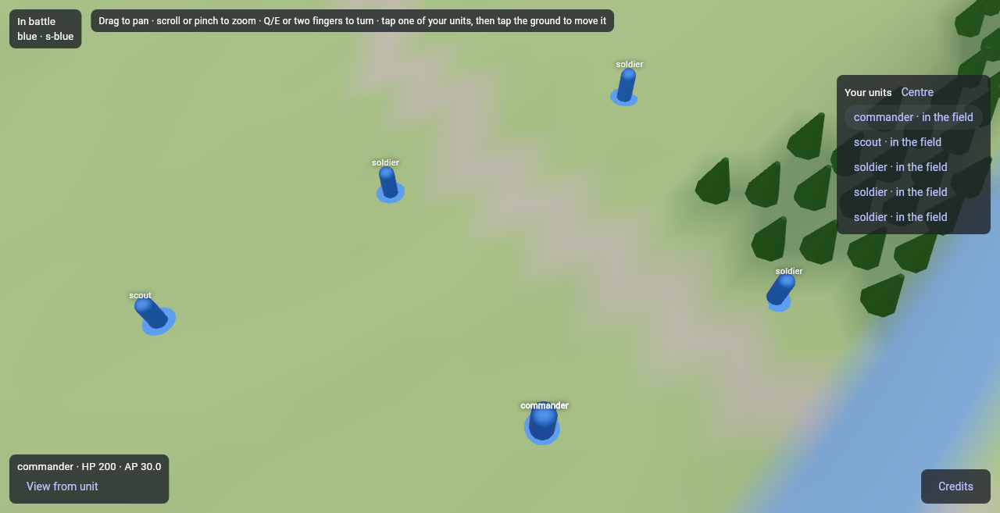
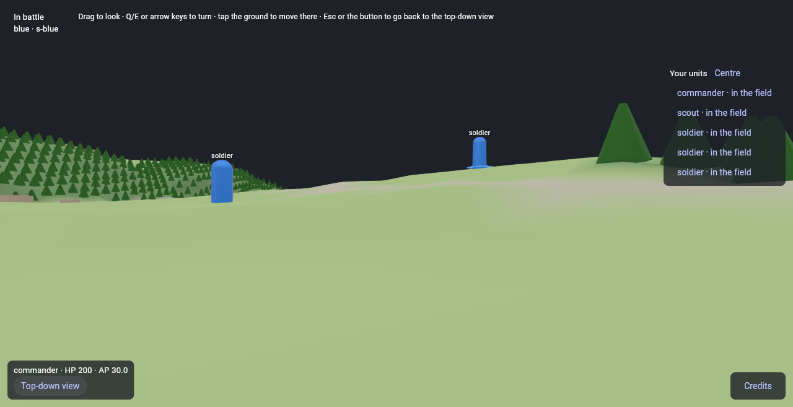
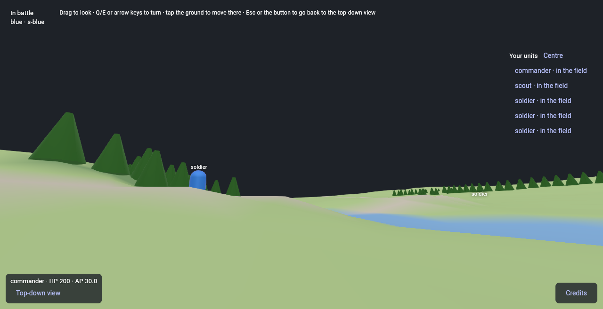
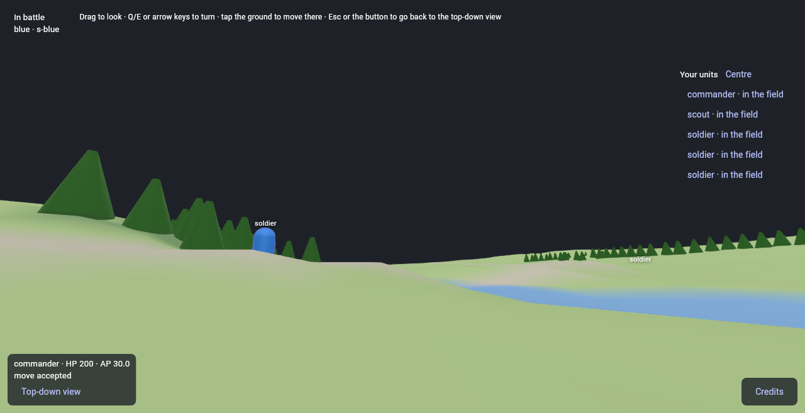
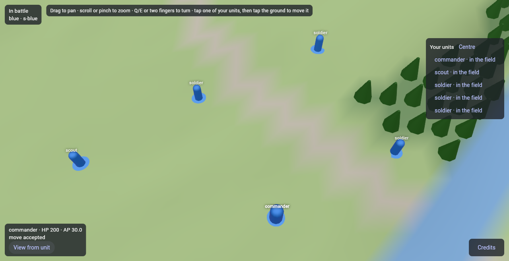
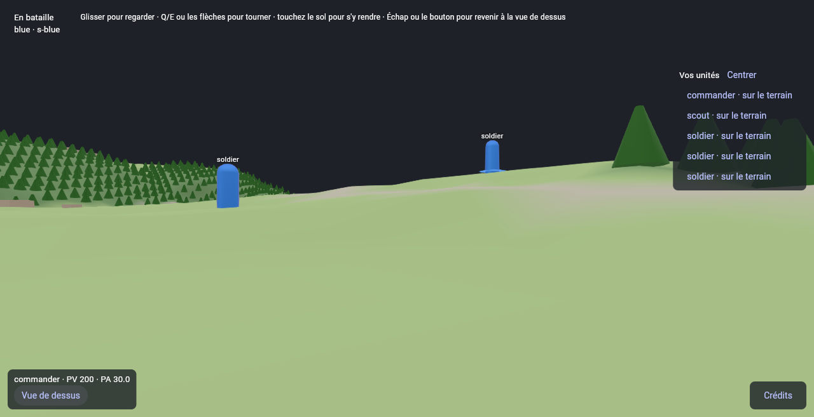

# Session M7.4: View from a unit

**Issue:** `apps/battle_team/plan/milestones/m7-client.md`, Issue 4. It is the specification of this session: read it entirely, with the milestone's "Conventions".
**Package:** `apps/battle_team` · **Branch:** `bt/m7-04-view-from-unit` · **Depends on:** M7.3.
**Skills:** `vgv-ai-flutter-plugin:animations`, `vgv-ai-flutter-plugin:bloc`, `vgv-ai-flutter-plugin:testing`, `vgv-ai-flutter-plugin:green-gate`; read `packages/flutter_scene/packages/flutter_scene/skills/flutter_scene-idioms/SKILL.md` and its `references/what-exists.md` (cameras, controllers).
**Read** (`plan/` is `apps/battle_team/plan/`): decision 5, MAP-04, MAP-26, COMBAT-14, decision 235 (sight from the top of the hit box); `plan/stack/04-client-and-rendering.md` (two cameras, frame budget: 60 fps in first person on phones); `plan/stack/03-networking.md` (the first-person move stream rate); `plan/stack/08-workload-placement.md` (AP between updates is client-computed); `plan/data/units.yaml` (`hit_box_m.height` = eye height); the session logs of M7.1 (the 3D seam) and M6.7 (`apAt`, clock sync).

## What exists
- `TopDownCamera` in `lib/battle/world/` (pan, zoom, turn); the `BattleWorld` interface + `SceneBattleWorld` (GPU) + `FakeWorld`; the cubit's selection (tap a unit, tap the ground).

## Steps
1. **Camera seam**: an `abstract interface class BattleCamera` with `TopDownCamera` and a new `FirstPersonCamera` (eye at the unit's position + `hit_box_m.height`, yaw/pitch from drag or two fingers, FOV from a constant in a `const` class, not a game number). The world interface gains `useCamera(BattleCamera)`; `FakeWorld` records it. Pattern: State (camera mode) or Strategy — name one in the doc comment.
2. **Cubit state**: `viewMode` (`topDown` | `firstPerson(unitId)`); enter from the selected own unit (a button on the unit panel), leave with a button or when the unit dies, is stored or leaves sight. Everything the UI needs is in state; no camera object in the bloc.
3. **Movement in first person**: a move order from the view is the same `Move` order to the tapped/aimed ground point; the stream rate of `stack/03` applies to what the client *renders*, not to orders. The AP shown between updates comes from `BattleClient.apNow`/`apAt` (M6.7).
4. **Fog in first person**: the GPU class draws only the units in the view (as today); confirm with the `FakeWorld` test that entering first person changes no set of drawn units.
5. **Record** the rate and the bytes it costs (count `TickUpdate`s and sizes over a one-minute run on the playtest battle, or the recorded streams) next to `stack/03`'s estimate, in the log and in `plan/stack/03-networking.md` (one line, on the same branch in `apps/battle_team`).
6. **Gates** (§4, §6); **show it** (web build or the owner's phone: a recording entering and leaving first person); **finish** (§5).

## Tests to write
- `decision 5 first person enters from an own unit and leaves to top-down` (bloc_test).
- `MAP-04 / decision 235 the eye sits at the unit's hit box height` (camera unit test with `hit_box_m` from the real data).
- `decision 237 entering first person draws the same units as top-down` (`FakeWorld`).
- First person ends when the unit is stored/dies (state transition tests).
- Widget test: the enter/leave buttons exist and are localized (en, fr).

## Stop and ask when
- The 60 fps floor cannot be judged without a device: say so in the log; M7.13 measures.
- Aiming (COMBAT-14, `FireAimed`) tempts you: it is M7.5's; stop at the camera and the move.

## Pitfalls
- Camera math is pure Dart: test it without flutter_scene (vector_math only).
- A quaternion from yaw/pitch drifts if you compose incrementally; rebuild from angles each frame.
- Do not edit anything under `packages/flutter_scene/`.

## Acceptance criteria
- [ ] The acceptance criteria of the issue (m7-client.md, Issue 4): the rate and its traffic are recorded; what the section does not see is not drawn in either mode (tests); the switch is shown in a web build, **not on a phone and not recorded as a video** (see the log).
- [x] The definition of done (`docs/battle_team/agent-workflow.md` §4 and §6).

## Session log

**Built** (2026-11-10, branch `bt/m7-04-view-from-unit`, stacked on `bt/m7-03-logging`: M7.1 and M7.3 were not merged, so this sits on top of both; only `apps/battle_team` changed, plus hawkbee's docs):
- `lib/battle/world/battle_camera.dart`: `abstract interface class BattleCamera` (`position`, `forward`, `fovY`, `near`, `insideUnit`), the camera **Strategy**. `ViewProjection` moved here from `top_down_camera.dart`; `view(size)` is an extension on any `BattleCamera`. `TopDownCamera implements` it.
- `lib/battle/world/first_person_camera.dart`: `FirstPersonCamera` (eye = the unit's feet + `eyeHeightM`; `yaw` and `pitch` are the state and `forward` is rebuilt from them at each read, so turning cannot drift; pitch within ±85°; yaw wrapped; `look(dragPixels)`, `turn`, `standAt`) and `FirstPersonLook`, the `const` class of display constants (FOV 70°, near plane 0.3 m, 0.005 rad per dragged pixel).
- `BattleWorld.useCamera(BattleCamera)`: the world draws through it and does not draw the body of `insideUnit`. `FakeWorld` records `camera` and `cameras`; `SceneBattleWorld` sets `Node.visible` (GPU file, still `coverage:ignore-file`).
- `lib/battle/data/unit_bodies.dart`: `UnitBodies` and `loadUnitBodies`: `hit_box_m.height` of each unit type (decision 235), read from the plan's own `plan/data/units.yaml`, which `pubspec.yaml` now bundles as an asset and `battle_rules`' `UnitsData.parse` reads (`battle_rules` is a new dependency of the app: pure Dart). No number of the game is in `lib/`.
- `BattleState.viewMode` (`ViewMode`: sealed `TopDownMode` | `FirstPersonMode(unitId)`), `seenFrom`, `canSeeFrom(unit)`. `BattleCubit.enterFirstPerson()` (from the selected own unit on the field) and `leaveFirstPerson()`; the cubit goes back to top-down on its own when an update shows the unit stored, carried, at 0 HP, off the map or gone, and when `select()` picks another unit or none. No camera object in the cubit.
- `BattleView` keeps one camera of each mode and follows `viewMode` (`setState` hands the scene the new camera, so the 3D area is rebuilt with it; coming back finds the overview where it was left). From the eyes: a drag with one or two fingers looks around, the arrows look, Q/E turn, **Escape goes back and keeps the unit selected**, a tap on the ground orders the same `Move` as from above (the ray runs from the eye), a tap on another unit of the section selects it (and so goes back), scroll, pinch and pan do nothing. The eyes follow the unit as it is **drawn**, so they glide to its destination with it (decision 236). The unit panel has the buttons **View from unit** and **Top-down view**; its AP is `BattleCubit.apNow` → `BattleClient.apNow`, between updates (M6.7), in both modes. The labels name every unit in sight but the one the eyes are in.
- `BattlePage` loads the bodies beside the map and `buildBattleScene` takes a `BattleCamera`.
- l10n in `app_en.arb` and `app_fr.arb`: `battleFirstPerson`, `battleTopDown`, `battleHelpFirstPerson`.
- Logging (M7.3's rules): `first person entered`, `left`, `ended: the unit is gone`, `ended: the selection changed` (no unit named), and a warning when the data has no body for a unit type.
- Docs: `agent-workflow.md` §6 (the camera seam, the unit data asset), `plan/stack/03-networking.md` (one paragraph, below).

**Checks**: `dart format` and `dart analyze --fatal-infos` clean; 140 tests (M7.3 left 101), **100 % line coverage** (807 of 807 lines of the 22 files the tests load), `optimization: false`. Rules and tests: decision 5 (`battle_cubit_test.dart` enter and leave from an own unit, ends when the unit is stored, carried, dead, off the map or gone, selection rules, the same `Move` order; `battle_view_test.dart` the camera follows the state, looks around, the move tap), decision 235 (`first_person_camera_test.dart` the eye at the hit box height of **every unit type of the real data**; `unit_bodies_test.dart`; `battle_view_test.dart` the eye at the drawn position and following it), decision 237 (`battle_view_test.dart` entering first person draws the same units as top-down, and a unit the section stops seeing is not drawn from the eyes; the logs name no unit), decision 236 (the eyes follow the glide), M7.4 (buttons and help in English and French, unknown unit type).

**Choices and deviations**
1. **MAP-04 is not the eye rule.** The brief and `stack/04` cite MAP-04 (map size, 2 to 5 teams) for the view from a unit. The rule that gives the eye height is MAP-26 with decision 235, so the tests cite decisions 5 and 235. I changed no spec.
2. **Movement is one `Move` per tap, not a stream of 5 orders a second.** `stack/03` says first-person movement is short orders, 5 a second while a direction is held; the brief says the stream rate applies to what the client renders and the order is the same `Move` to the aimed point. The host settles it: a unit stands in a **map cell (10 m on `saint_lo_1km`)**, its position is the cell's and a watcher is sent a position only when the cell changes (decision 236, `SectionViews.positionOf`), so a 1 m step is the same cell and tells nobody anything. The 5 a second only means something once units follow their paths on the host (M8, `stack/03`). I built the tap/aim move and no held-direction control. **Owner: say if `stack/03`'s sentence should change now, or when M8 lands.** I did not edit that sentence; the measurement below sits under it.
3. **Escape.** From above it still clears the selection; from the eyes it goes back and keeps the unit. `select()` of another unit from the eyes goes back to top-down.
4. **Where the view first looks.** Entering takes the overview's heading as its yaw and looks level.
5. **The eyes are the top of the hit volume of the type** (1.8 m for a soldier, 3.0 m for the artillery, from the data). The playtest draws units about three times their size so they show from above, so from the eyes a soldier ahead looks like a 6 m pillar (see the pictures). 3D models and their hit boxes come later (designer); I did not scale anything.

**Traffic** (step 5; recorded in `plan/stack/03-networking.md`). Measured with the real `BinaryProtocolCodec` over a **simulated** minute, 300 `Move` orders at 5 a second of a 1 m step each, built from an own unit of the recorded streams; **not a live host** (no Appwrite from the container). The throwaway script is not committed.

| | per message | per second | |
|---|---|---|---|
| A `Move` order, up | 55.6 B | 278 B | 2.2 kbit/s |
| `CommandAccepted`, down | 11.8 B | 59 B | 0.5 kbit/s |
| The mover's own update: its unit whole, with its AP and move end | 139.6 B | 698 B | 5.6 kbit/s |
| A watching section's update (position only) | 36.6 B | 183 B | 1.5 kbit/s |
| The mover, down in all | | 757 B | 6.1 kbit/s |

`stack/03` expected 38 B for a watcher's update (20 B a tick and 18 B for a moving unit, in its table), which this matches, and "under 0.5 kbit/s up" for a fight: a held-direction stream would be 2.2 kbit/s up and 6.1 kbit/s down for the mover alone, so the mover's whole own unit is the number to watch if M8 brings the 5 Hz stream. The recorded streams give no cleaner one-minute count: they are 26 to 35 ticks of a scripted battle.

**Not done, and why**
- **No phone, no video.** The container cannot run on a phone, and the screenshot loop under software WebGL gave 24 frames in 15 s, a slide show. The acceptance criterion wants a recording on a phone switching the two views: **to do on the owner's side**, development flavor on the phone against the host (`playtest.md`): select a unit, View from unit, drag, tap the ground, Top-down view; paste the recording here.
- **The 60 fps floor in first person** cannot be judged without a device (the brief's stop rule): M7.13 measures it. The software-GL run only shows that it draws.
- **No live host**: the pictures are the real `BattlePage`, repository, cubit and flutter_scene world over an in-memory host (a throwaway entry, not committed), as in M7.1. "Move accepted" is the in-memory host's answer; the unit does not move in them.

**Seen in the pictures, not fixed** (outside the issue): no sky, so the scaffold colour shows above the horizon; a unit's name floats over the terrain that hides it (the section does see it; M7.9 may shade it); units at three times their size (above). A unit stored while the player looks through it sends the view back to the overview without a message.

**Pictures** (web build, headless Chromium, software WebGL; I looked at each one):

| Selected, top-down | First person, English | Looking east (river, trees) |
|---|---|---|
|  |  |  |

| Tap on the ground: the move order | Back above, the unit still selected | First person, French |
|---|---|---|
|  |  |  |
