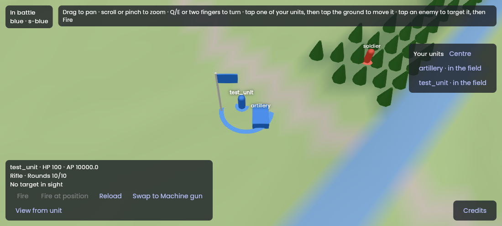
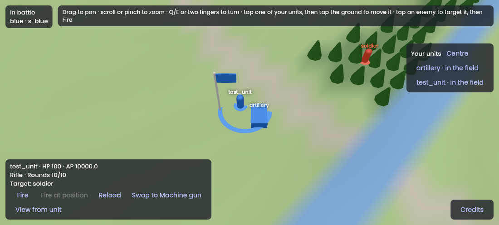
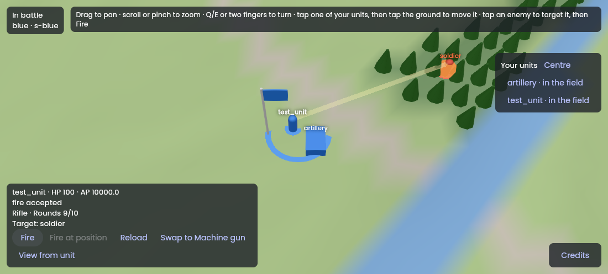
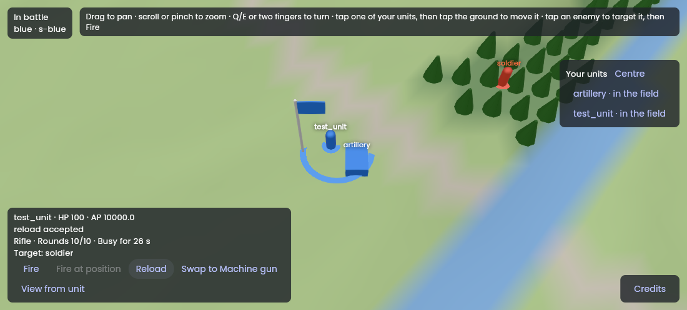
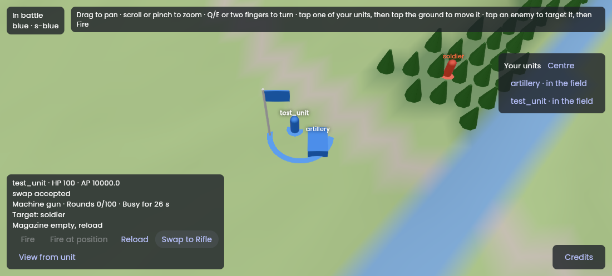
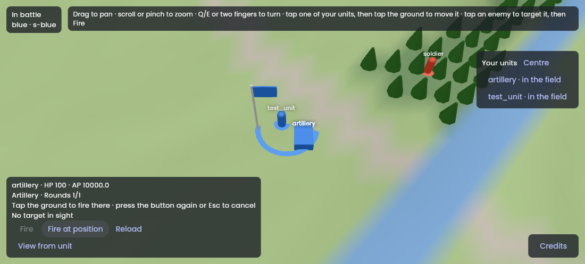
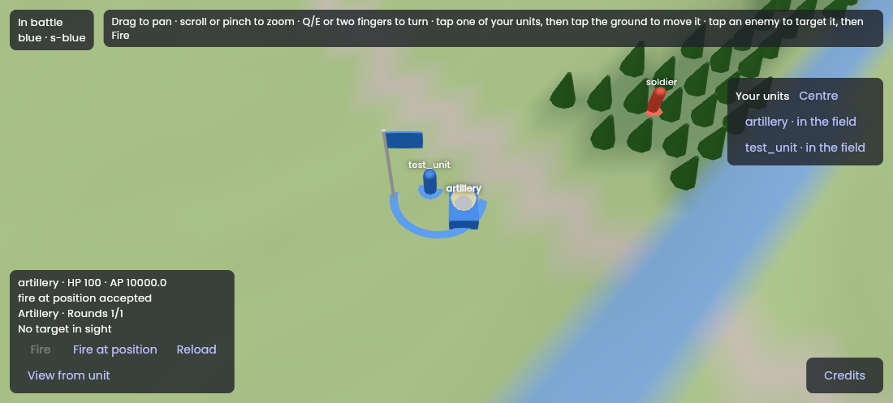
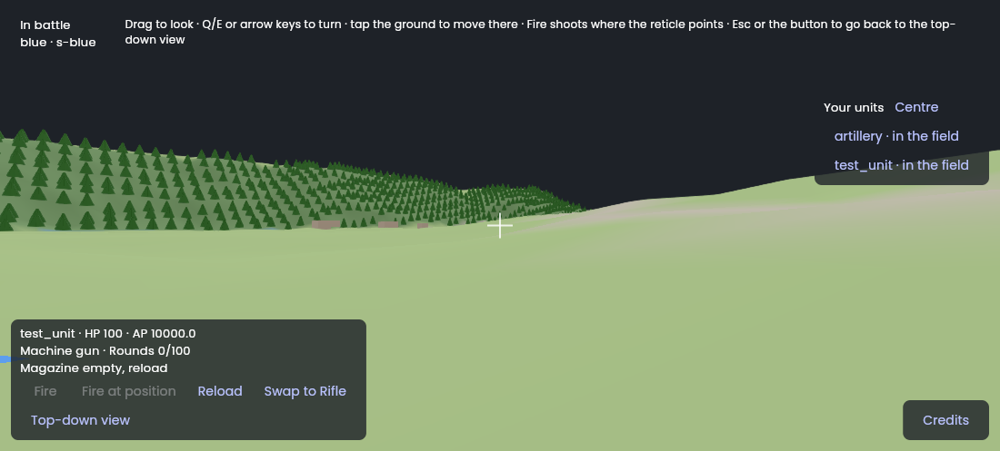
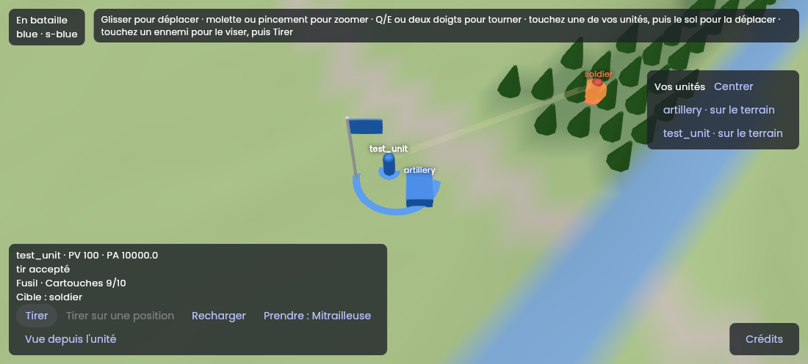

# Session M7.5: Fire

**Issue:** `apps/battle_team/plan/milestones/m7-client.md`, Issue 5. It is the specification of this session: read it entirely, with the milestone's "Conventions".
**Packages:** `apps/battle_team`, `packages/battle_client` (pre-check) · **Branch:** `bt/m7-05-fire` · **Depends on:** M7.4 (M7.2 for fast manual runs).
**Skills:** `vgv-ai-flutter-plugin:bloc`, `vgv-ai-flutter-plugin:animations`, `vgv-ai-flutter-plugin:testing`, `vgv-ai-flutter-plugin:green-gate`.
**Read** (`plan/` is `apps/battle_team/plan/`): COMBAT-11 to COMBAT-26 (`plan/specs/70-combat-and-ap.md` §2 to §4), COMBAT-57, COMBAT-58, UNIT-38; decisions 183, 234, 237; `plan/data/combat.yaml`, the weapon entries of `plan/data/units.yaml`; `packages/battle_protocol/lib/src/orders.dart` (`Fire`, `FireAtPosition`, `FireAimed`, `Reload`, `SwapWeapon`) and `messages.dart` (`Fired`, `UnseenHit`, bursts in `TickUpdate`); the session logs of M6.2 (what a section learns of a shot), M6.7 (`HeldView` hits and bursts), M7.4.

## Steps
1. **Read the five orders and the hit/burst messages** in `battle_protocol` before designing: the UI shows exactly what `HeldView` holds, nothing more.
2. **Weapon panel** on the selected own unit: weapon name, rounds (`UnitPrivate.rounds`), reload state, the swap list; buttons Fire (at the selected target), Fire at position (then tap the ground), Reload, Swap. In first person (M7.4): an aim reticle and `FireAimed` with the aim direction the camera gives.
3. **Pre-check in `battle_client`** (stack decision 8, display only): range and AP for a shot from `battle_rules` on the view's data; the button shows "out of range"/"no AP" before sending. The host's answer wins: a refusal that the pre-check missed is shown as the host's.
4. **Drawing** through the `BattleWorld` seam: `showShots(Iterable<ShotEffect>)` — a tracer from the shooter to the target or position for a seen `Fired`, a hit mark on a seen unit for a hit, and for an `UnseenHit` only the hit mark on the own/seen unit: no origin, no direction (decisions 234, 237). `FakeWorld` records the effects; the GPU class draws them with Flutter's animation system (`vgv-ai-flutter-plugin:animations`), short-lived.
5. **Refusals** (AP, range, rounds, UNIT-38, target not seen) surfaced on the panel, localized en + fr.
6. **Decision 237 proof**: a bloc test over a recorded stream with unseen hits and a `Fired` whose target is unseen: the effects hold no shooter for the first and no target for the second.
7. **Gates** (§4, §6) for `battle_client` and the app; **show it** (recording: a test unit firing each way); **finish** (§5): `battle_client` PR first.

## Tests to write
- `COMBAT-11 fire needs a seen target` (pre-check and UI state), `COMBAT-12 fire at position for indirect-fire units only`.
- `COMBAT-14 aimed fire from first person sends FireAimed with the camera's direction`.
- `COMBAT-57 / decision 234 an unseen hit shows the hit, not the shooter`; `COMBAT-58 / decision 237 a shot at an unseen target shows the shooter firing, outcome unknown`.
- `UNIT-38 an action the unit lacks is refused before sending`.
- `Reload` and `SwapWeapon` update the panel from the next `UnitPrivate`.
- Widget tests of the panel (buttons, localized labels, disabled states).

## Stop and ask when
- `HeldView` lacks a field the panel needs (e.g. the weapon list of a unit): propose the protocol change (M6 conventions) and ask before touching `battle_protocol`.

## Pitfalls
- Shot effects are transient view state; keep them out of the persistent cubit state or they replay on rebuilds. A separate `ShotEffects` controller (Observer) is fine — name the pattern.
- Range checks use the host's distance rule (3D positions, decision 235); copy nothing, call `battle_rules`.

## Acceptance criteria
- [x] The acceptance criteria of the issue (m7-client.md, Issue 5): a test unit fires each way (at a target, at a position with the artillery, aimed from first person), hits and unseen hits are drawn as decisions 234 and 237 demand and proven over the recorded streams plus a hand-written update, and the session shows it in **pictures from a web build over an in-memory host — not on the playtest battle (no Appwrite from the container) and not as a video** (see the log).
- [x] The definition of done (`docs/battle_team/agent-workflow.md` §4 and §6).

## Session log

**Built** (2026-11-10, branch `bt/m7-05-fire` from `main` in `battle_client`, `battle_team` and hawkbee; M7.1 to M7.4 and M7.2 were all merged by then; no protocol change: `HeldView` already holds the weapon, the rounds, `busyUntil` and the section's spare weapons):
- `battle_client` `lib/src/pre_check/order_pre_check.dart`: `OrderPreCheck` (on `battle_rules`' `CombatData` and `UnitsData` and the storage radius): `fire`, `fireAtPosition`, `fireAimed`, `reload`, `swap`, `swappable`, `weaponType`; results `PreCheckPassed(apWait)` and `PreCheckRefused(PreCheckRefusal)`, whose `code` is the host's refusal code (`out_of_range`, `target_not_seen`, `no_weapon`, `empty_magazine`, `cost_above_ap_max`, `not_indirect`, `not_aimed`, `cannot_hit_flying`, `not_allowed`, `not_in_storage`, `not_at_storage`, `not_on_field`), so a pre-check and the host's answer read the same. `battle_client` gained `battle_rules` and `equatable`.
- App `lib/battle/data/order_checks.dart`: `loadOrderPreCheck` reads the bundled `plan/data/combat.yaml`, `units.yaml` and `battle.yaml` (new assets).
- App `lib/battle/shots/`: `ShotEffect` (sealed: `Tracer`, `MuzzleFlash`, `HitMark`) and `ShotEffects`, the Adapter from a `TickUpdate` to effects. It reads only `events` (a single seen shot is an `Attacked`), `bursts`, `fired` and `unseenHits`, so an effect holds only what the section was told: a hit by an unseen shooter is a `HitMark` alone, a shot at an unseen target is a `MuzzleFlash` alone, never a tracer. A killed target has left the view when its message is applied, so positions fall back to the view at the previous message.
- `BattleRepository.shots` and `BattleCubit.shots` (a stream, not state: nothing replays on a rebuild); `BattleSnapshot.section` and `BattleState.storedWeapons`, `targetId`, `groundFire`. The cubit: `target`, `fireSelected`, `toggleGroundFire` + `fireSelectedAt`, `fireAimed(Direction)`, `reload`, `swap`, and `checkFire`, `checkFireAtPosition`, `checkFireAimed`, `checkReload`, `checkSwap`, `swappableWeapons`, `magazineOf` for the buttons. An order the pre-check expects refused is not sent: the notice says why and the log says `order fire not sent: <code>` (no unit, no position). The cubit takes the `OrderPreCheck` as a constructor argument; `BattlePage` loads it with the map and the bodies.
- `BattleWorld.showShots(Iterable<ShotEffect>)` and a `target` on `show(...)`; `FakeWorld` records both; `LiveShots` (pure Dart, `lib/battle/world/live_shots.dart`) keeps each effect's short life (tracer 0.25 s, flash 0.15 s, hit 0.6 s, `ShotLook`), eased with Flutter's `Curves` (swell out, fade in), ageing at most 50 ms a frame so a hitching frame never skips a shot; `SceneBattleWorld` (GPU, `coverage:ignore-file`) draws them: a thin box for the tracer, spheres for the flash and the hit mark, alpha-blended and faded each frame. The target gets a white highlight (not obvious in the software-GL pictures) and its name in orange, which shows.
- `lib/battle/widgets/weapon_panel.dart`: `WeaponPanel` (weapon, rounds, busy seconds, the target, one hint line, buttons Fire / Fire at position / Reload / one Swap per spare weapon the type may use) and `AimReticle`; `BattleView` hands the shots to the world, targets on a tap on another section's unit, fires at the position the next tap on the ground names while armed, Escape disarms first, the panel's Fire from first person is `FireAimed` along `directionOf(camera.forward)` (`battle_space.dart`, the inverse of `worldOf`). The unit panel shows the answer to an order only with the unit it was for.
- l10n in `app_en.arb` and `app_fr.arb`: weapons, rounds, busy, buttons, target, AP wait, one `battleRefusal` select for every refusal code the pre-check or the host gives, the new order names, and both help lines.
- Docs: `agent-workflow.md` §6 (the shots seam, the pre-check, `real_cubit.dart`, the `runAsync` trap, two screenshot traps), `playtest.md`.

**Checks**: `dart format` and `dart analyze --fatal-infos` clean in both; `battle_client` 130 tests (38 new), **100 % line coverage** (564 of 564); app 221 tests (140 after M7.4), **100 % line coverage** (1080 of 1080 lines of the 27 files the tests load; `SceneBattleWorld` stays ignored), `optimization: false`. Rules and tests: COMBAT-11 (pre-check, cubit, panel and view: no target, out of range, a target of another section tapped, the target named), COMBAT-12 and COMBAT-55 (indirect fire only, armed tap, range), COMBAT-13 and UNIT-38 (no weapon, not on the field: refused before sending), COMBAT-14 and decision 183 (`FireAimed` carries the camera's direction, proven through the real cubit, repository, codec and `FakeHost`; artillery is not aimed), COMBAT-25 (a flier the weapon cannot hit), COMBAT-26, COMBAT-28 and decision 151 (swap list, at the storage place, in storage), COMBAT-33 (reload, empty magazine), COMBAT-04 and COMBAT-06 (AP: a shot short of AP waits and is sent; dearer than the pool holds is refused), COMBAT-57 / decision 234 and COMBAT-58 / decision 237 (`shot_effects_test.dart` on the mapper, `shots_over_the_stream_test.dart` over a recorded stream with a hand-written unseen hit and a `Fired` at an unseen target through the real cubit, `battle_view_fire_test.dart` into the world), decision 237 for the log (no unit, position or direction in any record).

**Choices and deviations**
1. **"No AP" is not a refusal.** COMBAT-06: a shot short of AP waits for them. The panel says "Waits 1.5 h for AP" and the button stays on; only a shot dearer than the pool can ever hold (`cost_above_ap_max`) is refused. The brief says the button shows "no AP"; I followed the spec.
2. **Range is the host's, a horizontal distance.** The brief's pitfall says 3D positions (decision 235). The host measures range as the horizontal distance between the cells' centres (`World.distanceM` in `battle_host`); decision 235's 3D lines are for sight, not range. Two views' positions are those centres, so `OrderPreCheck` computes the same number. **Owner: say if range should be 3D**; that is a host change first.
3. **The pre-check cannot see what the host sees.** Whether the unit itself sees its target (COMBAT-11) or whether its section sees a position (COMBAT-12) needs the map and the weather: the pre-check only asks that the target be in the section's view and passes the rest. The host's `target_not_seen` or `position_not_seen` shows, localized, like any refusal. It reads the default storage radius of the bundled `battle.yaml`; a battle that overrides it may differ (display only).
4. **A plain miss shows as a flash.** The host sends a seen shooter's shot that missed, or hit something unseen, as `Fired`; the client cannot tell the two, so it draws the shooter firing and nothing more (decision 237). A single seen hit is an `Attacked` event, several a `Burst`.
5. **A tap on another section's unit is a target, friend or foe**, and no longer falls through to the ground and moves; selecting another unit, or the target leaving sight, clears it. HQs and objects are not tappable targets yet (`Fire` accepts them, and a hit on an HQ is drawn).
6. **From first person Fire is `FireAimed`**; Fire at a target is offered from above only; Fire at position works from both.
7. **The panel names `Magazine empty, reload` for 0 rounds**, where the host says `not_loaded` after a swap or an unload: the client does not see the `loaded` flag, both need a reload.
8. **The answer to an order shows with its own unit** (M7.1 showed the last answer whatever was selected, so the test unit's "fire accepted" read as the artillery's).
9. The muzzle and hit heights of the effects are for the drawing (units are drawn about three times their size), not rules.

**Found, not fixed**
- **The host's order chain refuses every unit order of a unit that is not on the field**, `SwapWeapon` included (`order_chain.dart`: only `Deploy` and `BuyNode` pass), while COMBAT-28 says a weapon is swapped while the unit is stored or next to its storage place. The pre-check mirrors the host (`not_on_field`), so a stored unit cannot swap in the app. For M7.6 (storage) to settle with the owner.
- The panel with all its lines is large: in landscape on a phone it covers about a third of the screen. M7.13 or the designer.

**Not done, and why**
- **Not on the playtest battle, no video.** Appwrite is out of reach from the container, so the pictures are the real `App`, repository, cubit and flutter_scene world over a scripted in-memory host (a throwaway entry, not committed): a test unit with a rifle, an artillery piece, two enemies, a machine gun in storage. **To do on the owner's side**: run the development flavor against the playtest host (`playtest.md`), select the test unit, tap an enemy, Fire; arm the artillery's Fire at position and tap the ground; View from unit, Fire; and paste a recording here. The 60 fps floor with effects on screen is M7.13's.
- A shot's tracer is one box from muzzle to target and the hit mark a sphere: placeholders until the 3D models (designer).

**Pictures** (web build, headless Chromium, software WebGL; I looked at each one; the tracer and the flash live a fraction of a second, so they are single captures right after the click):

| Test unit selected, no target | A target tapped: named in orange | Fire: tracer and hit mark |
|---|---|---|
|  |  |  |

| Reload: busy for the rest of it | Swap: new weapon, empty magazine | Artillery: Fire at position armed |
|---|---|---|
|  |  |  |

| Artillery fired at a position: a flash, outcome unknown | First person: the reticle | First person: aimed fire accepted |
|---|---|---|
|  |  |  |

| French |
|---|
|  |
