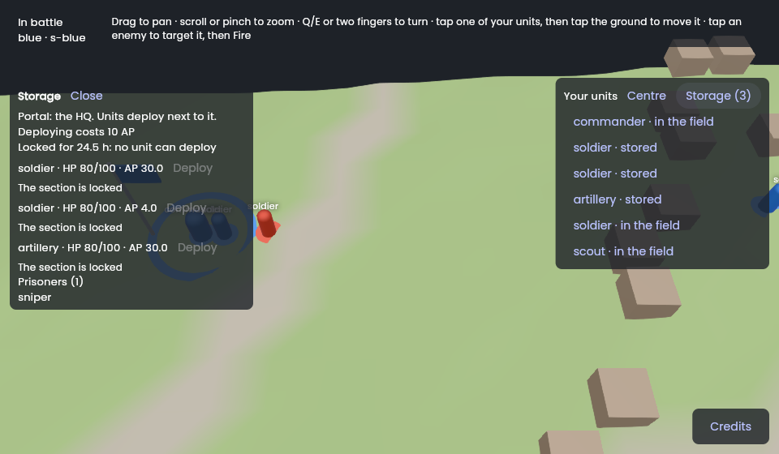
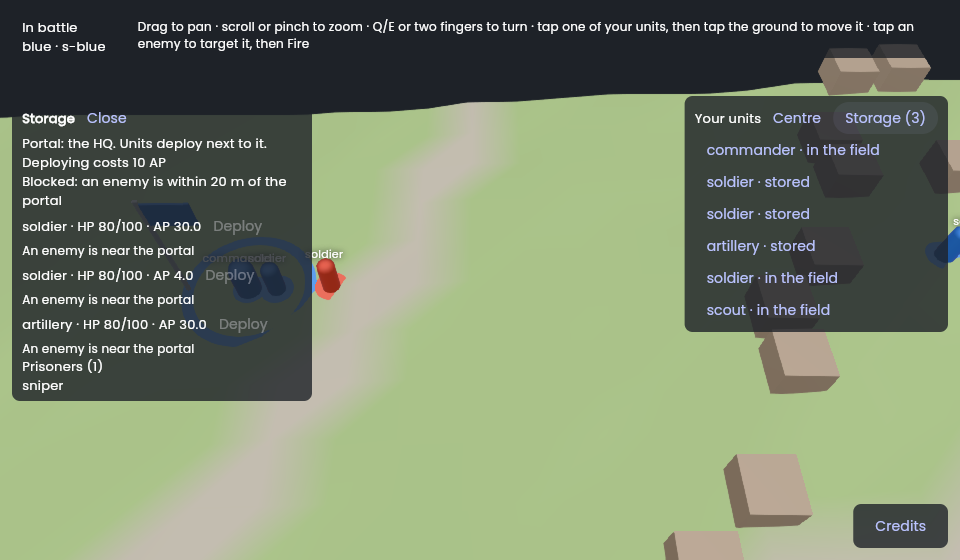
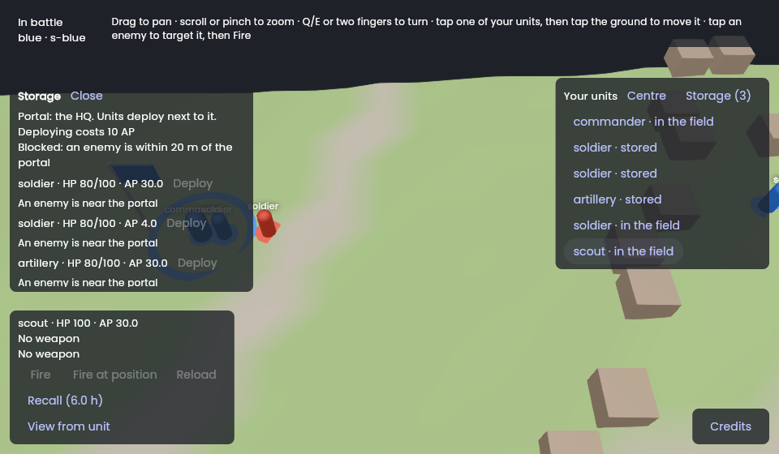
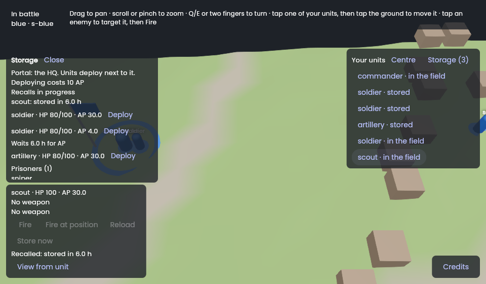
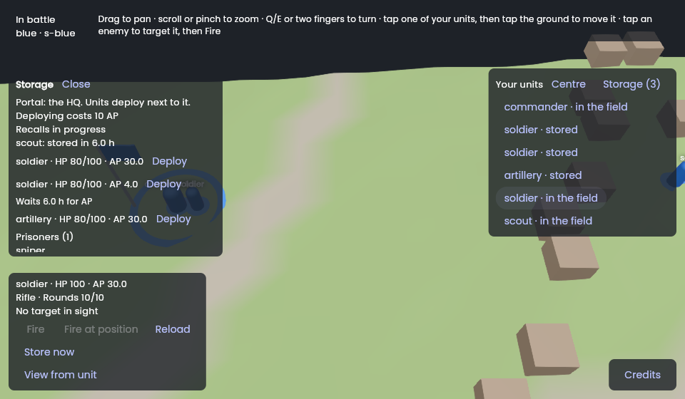
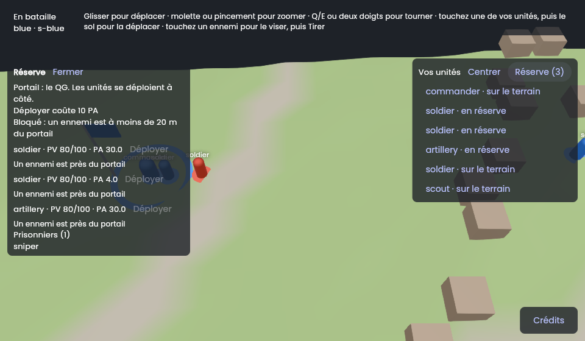

# Session M7.6: Storage: view, store, unstore

**Issue:** `apps/battle_team/plan/milestones/m7-client.md`, Issue 6. It is the specification of this session: read it entirely, with the milestone's "Conventions".
**Packages:** `apps/battle_team`, `packages/battle_client` (pre-check) · **Branch:** `bt/m7-06-storage` · **Depends on:** M7.1 (M7.2 for fast manual runs).
**Skills:** `vgv-ai-flutter-plugin:bloc`, `vgv-ai-flutter-plugin:testing`, `vgv-ai-flutter-plugin:accessibility`, `vgv-ai-flutter-plugin:green-gate`.
**Read** (`plan/` is `apps/battle_team/plan/`): HQ-29, HQ-31 to HQ-36, HQ-39, HQ-46, MAP-50; decisions 110, 120, 125, 204, 240; `plan/data/battle.yaml` (`storage:`); `battle_protocol` `orders.dart` (`Store`, `Recall`, `Deploy`) and the private view (`UnitPrivate.place`, locks, prisoners); the session logs of M5.4/M5.12 (storage rules and orders) and M7.1 (where the playtest's Deploy button is).

## Steps
1. **Storage screen** (`lib/storage/`, a bloc on the same `BattleRepository`, or a panel of the battle feature — choose the one that keeps the battle cubit small; say why): stored units with type and HP, the portal, the deploy cost (`deploy_ap`), the lock (HQ-35) with remaining time, "blocked: enemy within 20 m" (HQ-36), the recall in progress with its remaining time, prisoners.
2. **Orders**: `Store` from a selected own unit on the field (instant within `store_radius_m`, else the recall delay — show which before sending), `Recall`, `Deploy` from the storage list (the playtest's Deploy moves here; remove the old button).
3. **Private state only**: the view reads `UnitPrivate` and the section's private state; nothing of other sections (HQ-29). Deploy places the unit at the nearest free place to the portal (MAP-50): the UI shows the host's answer, it computes nothing.
4. **Refusals** (locked, blocked, not stored, cost above AP) surfaced with their reasons, localized en + fr.
5. **Accessibility**: labels on every button, the list readable by a screen reader (`vgv-ai-flutter-plugin:accessibility`).
6. **Gates** (§4, §6); **show it** (screenshot of the storage screen with a lock and a blocked state — drive the state from a recorded stream or the fake host); **finish** (§5).

## Tests to write
- `HQ-33 deploy sends Deploy for a stored unit and shows its cost`; `HQ-35 a locked section shows the lock and disables deploy`; `HQ-36 an enemy within 20 m shows blocked`.
- `HQ-31/32 store within store_radius_m is instant, farther shows the recall delay`.
- `HQ-29 the storage view shows only the section's own stored units` (a stream with another section's units).
- Widget tests: list, buttons, disabled states, en and fr.

## Stop and ask when
- The private view lacks the lock's end time or the nearest-enemy state: ask whether this session may extend `battle_protocol` (M6 conventions) or shows what it has.

## Pitfalls
- Remaining times come from the host's battle time (`BattleClient.battleTime`), not `DateTime.now()`.
- Keep numbers out of `lib/`: `deploy_ap`, `store_radius_m` come from the view/data, never a literal.

## Acceptance criteria
- [x] The acceptance criteria of the issue (m7-client.md, Issue 6): store, recall and deploy from the view, a blocked deployment and the lock shown with their reasons, and a picture in the log. **Not on the playtest battle** (pictures from a web build over a scripted in-memory host, see the log).
- [x] The definition of done (`docs/battle_team/agent-workflow.md` §4 and §6).

## Session log

**Built** (2026-11-10, branch `bt/m7-06-storage`, stacked on `bt/m7-05-fire` in hawkbee, `battle_team` and `battle_client`: M7.5 is not merged and the session touches its cubit and its pre-check; no protocol change):
- `battle_client` `OrderPreCheck` (constructor now takes the plan's `StorageSettings` instead of the radius alone): `store` gives a `StorePlan` (`StoredNow`, `RecalledAfter(takes)`, `StoreNotPossible(reason)`; HQ-31, HQ-32, HQ-30, HQ-49) and `deploy` a `PreChecked` (not stored, prisoner, locked, blocked by a seen enemy within `deploy_block_radius_m` of the portal, `deploy_ap` against the pool, the wait for missing AP as for a shot, COMBAT-06). New refusal codes, the host's own: `not_stored`, `is_prisoner`, `section_locked`, `blocked_by_enemy`, `never_stored`, `carries_units`, `already_recalled`. `HeldView.recalls`: the battle time each recall of the section ends, from `RecallBegan` until `UnitStored`, `UnitDeployed` or the unit leaves the view.
- App `lib/storage/`: `StorageCubit` (`storage_cubit.dart`, `storage_state.dart`), `StoragePanel`, `StoreButton`, `EverySecond`. **A cubit of its own on the same `BattleRepository`, not part of `BattleCubit`**: the battle cubit is about the field (selection, target, weapon, camera) and was 370 lines; storage is its own concern (the lock, the portal, the stored list, the recalls, the prisoners) and needs none of the battle state, only the snapshots, which both read. They share no state; `BattlePage` provides `StorageCubit` first and not lazily, so it follows the view from the first message. The cubit takes `units`, `portal` (the own team's HQ), `lockedUntil`, `prisoners` and `recalls` from `BattleSnapshot` (which gained `recalls`) and offers `planStore`, `checkDeploy`, `lockRemaining`, `recallRemaining`, `storeOrRecall`, `deploy`; an order the pre-check expects refused is not sent (the notice says why, the log says `order deploy not sent: <code>`).
- The storage panel (opened by the "Storage (n)" button of the units panel): portal, what a deployment costs, the lock with its remaining time, "Blocked: an enemy is within 20 m of the portal", the recalls on their way, each stored unit with type, HP and AP and its own Deploy button (off with the reason, or on with "Waits 6.0 h for AP"), the prisoners, the answer to the last deployment. Times count down on the battle time of the client (`EverySecond` rebuilds each second; the clock is `battleTime`, never the device's). **The playtest's Deploy button is gone**: `BattleCubit.deploy` and the button in the units list moved here. The selected own unit on the field gets a Store button: "Store now" next to the portal, "Recall (6.0 h)" from afar, "Recalled: stored in 3.0 h" while a recall runs, the reason when it cannot (`never_stored`, `carries_units`).
- Small refactors the session needed: `sendOrder` (`lib/battle/data/order_sender.dart`, send + log + the host's code) is shared by the two cubits; `formatWait`/`formatAp` (`lib/battle/widgets/wait_format.dart`) by the weapon panel and the storage widgets.
- l10n en + fr: `storage*` keys, the order names `store` and `recall`, the seven new refusal codes in `battleRefusal`; `battleDeploy` became `storageDeploy`.

**Checks**: `dart format` and `dart analyze --fatal-infos` clean in both; `battle_client` 148 tests (18 new), **100 % line coverage**; app 269 tests (221 after M7.5), **100 % line coverage**, `optimization: false`. Rules and tests: HQ-31/32 (`store`: instant within the radius, the recall delay beyond it, already recalled, a portal not in sight, `StoreButton` shows which), HQ-30 and HQ-49 (never stored, carries units), HQ-33 (Deploy sent through the real cubit, repository, codec and `FakeHost`; the cost shown; a unit short of AP waits and is sent; a pool that never holds the cost refused), HQ-35 (the lock shown, deploy off, the countdown follows the battle time and ends), HQ-36 (a seen enemy within 20 m blocks), HQ-39 (no portal in sight blocks nothing client-side), HQ-37 (prisoners listed), COMBAT-43 (a prisoner is not deployed), HQ-29 (over the recorded streams and a hand-written other-section unit: only the section's own stored units are listed), decision 237 (an enemy the section does not see gives no clue: the button is on, the host's `blocked_by_enemy` shows as the host's; no unit in any log record), M7.6 in the battle view (the Storage button opens and closes the panel, the Store button on the selected unit), accessibility (headers, labelled buttons: "Deploy soldier", "Store soldier"), French.

**Choices and deviations**
1. **The pre-check knows only the enemies the section sees.** HQ-36 needs every enemy within 20 m of the portal; the view holds the seen ones. A deployment with an unseen enemy near looks possible, is sent and refused by the host, and the refusal shows (decision 237: "the unseen leaves no clue", and the brief's stop-and-ask about "the nearest-enemy state" is settled this way: no protocol change). The lock's end time is in `SectionPrivate.lockedUntil` already.
2. **The lock is checked before the enemy**, as the host does (`StorageRules.deploy`): a locked section with an enemy near says "locked", the blocked line appears when the lock is over.
3. **Recall in progress comes from the `RecallBegan` event only**, kept in `HeldView.recalls`; the whole view does not hold it, so a reconnecting client forgets it (Q-HQ-15, assumed). The recall time itself (`recall_s`) is from the plan's `battle.yaml` (default; a battle that overrides it may differ: display only).
4. **The portal is the team's HQ**; a guild camp (HQ-27) is not in the section's view as a storage place (Q-HQ-13, assumed).
5. **Swap from storage is still refused**, as M7.5 found: the host refuses every unit order of a unit that is not on the field, `SwapWeapon` included, while COMBAT-28 says swap while stored. The app mirrors the host (Q-HQ-14, assumed): a host change first.
6. **A panel, not a screen of its own.** The issue says "storage screen" or "a panel of the battle feature"; a panel over the battle keeps the field visible while deploying. It is at most as tall as the screen minus the selected unit's panel (200 px) and scrolls; in landscape on a phone (about 360 px high) that is about 100 px, so M7.13 or the designer may want a sheet.
7. `Store` is sent only within the radius and `Recall` only beyond it (the plan says which); the host's order chain accepts both anywhere and a `Recall` within the radius stores at once, so a stale view cannot make it worse.

**Found, not fixed**
- `BlocProvider`'s `context.watch` did not redraw a widget on a cubit's state change under a mocked parent in a widget test; `BlocBuilder`/`BlocSelector` are used for the storage cubit, and a cubit created in `setUp` lives in the real zone, so `tester.runAsync(pumpEventQueue)` settles it (the M7.5 trap, again).
- A dirty `docs/battle_team/sessions/m6-06-reaching-a-battle-host.md` was found in the working tree at the start (`dabocker compose` typo in the Docker steps, not from this session): left out of the commits.

**Not done, and why**
- **Not on the playtest battle, no video**, for the reasons of M7.5's log (the playtest tool closes the owner's running battle and resets passwords; `bt_battles.settings` and the redeployed `bt_create_battle` are the owner's to push; the tool puts nothing of red on the field). **To do on the owner's side**: run the development flavor against the playtest host, open Storage, deploy a stored unit, store a unit next to the HQ, recall a far one; and paste a recording here. The 60 fps floor is M7.13's.
- The test unit has no stored units at the start of the playtest (every unit is deployed), so a live run needs "Store now" first.

**Pictures** (web build, headless Chromium, software WebGL; I looked at each one; a scripted in-memory host, the real `App`, repository, cubits and flutter_scene world: a commander and a rifleman at the HQ, a scout 120 m away, three stored units, a red soldier 15 m from the HQ, a 24.5 h lock; after 22 s the lock ends, after 45 s the enemy leaves and the scout is recalled):

| Locked: deploy off, with the remaining time | Lock over, an enemy within 20 m: blocked |
|---|---|
|  |  |

| A far unit selected: the recall and its delay | Recall running, a unit waiting for AP |
|---|---|
|  |  |

| A unit at the HQ: store now | French: blocked |
|---|---|
|  |  |
