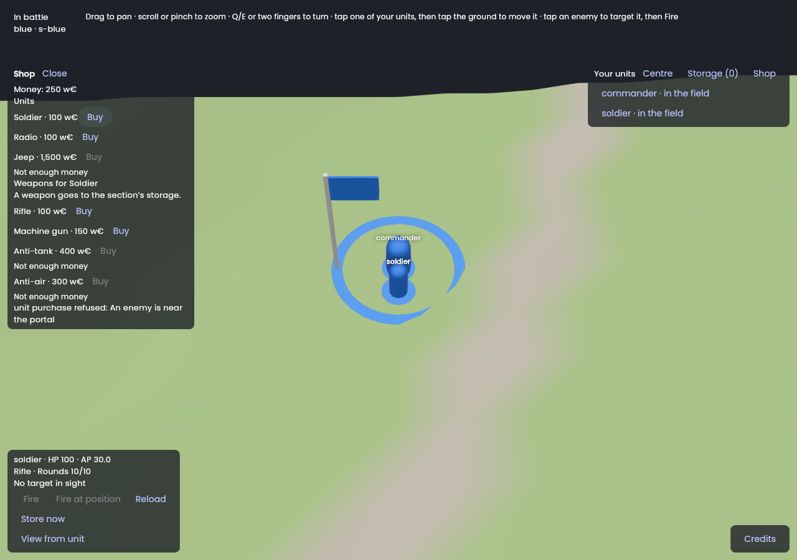
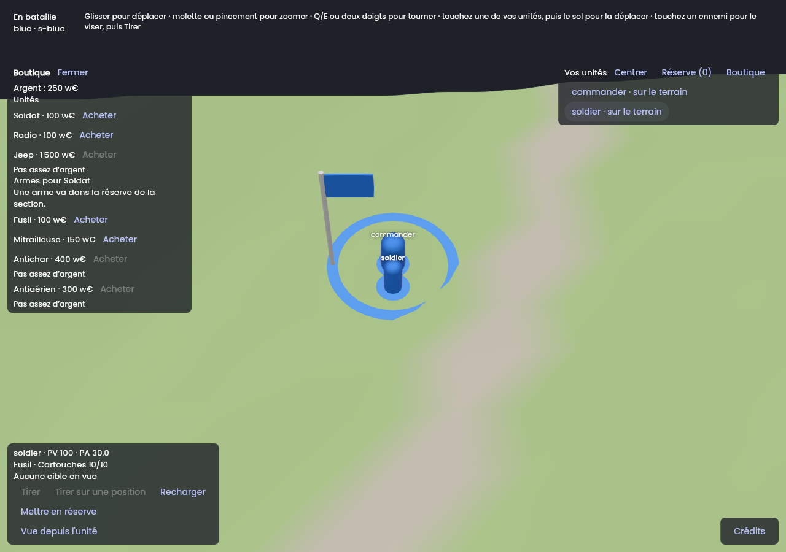

# Session M7.7: Buy

**Issue:** `apps/battle_team/plan/milestones/m7-client.md`, Issue 7. It is the specification of this session: read it entirely, with the milestone's "Conventions".
**Packages:** `packages/battle_protocol`, `packages/battle_host`, `packages/battle_client`, `apps/battle_team` · **Branch:** `bt/m7-07-buy` · **Depends on:** M7.6.
**Skills:** `vgv-ai-flutter-plugin:bloc`, `vgv-ai-flutter-plugin:testing`, `vgv-ai-flutter-plugin:green-gate`.
**Read** (`plan/` is `apps/battle_team/plan/`): ECO-04 to ECO-07, HQ-42, HQ-46, COMBAT-27, UNIT-44; decisions 129, 130, 147, 205, 210, 239; `plan/data/units.yaml` (prices, `common_stats`), `plan/data/economy.yaml`; `battle_protocol` `orders.dart` (`BuyUnit`, `BuyWeapon`); the session logs of M5.3 (money), M5.12 (purchases) and M7.6.

## Steps
1. **The roster comes from the host** (designer, 2026-11-10): the app ships no `plan/data` copy and never will. Add a `Roster` host message in `battle_protocol` (unit types the battle allows — `test_unit` only when `test_units` is on — with price, display name key and category; the weapons with their prices), sent by `battle_host` with the whole view (M6.4's `SectionSubscriber`), held by `battle_client`'s `HeldView`. M6's conventions: frozen samples, both encodings, size recorded next to `stack/03`. Read M6.2's log for the procedure before writing the message.
2. **Shop screen** (`lib/shop/`, same repository): the section's money; the roster with prices (the `test_unit` only when the battle allows it, UNIT-44); `BuyUnit`; for a selected own unit, `BuyWeapon` with the weapon list and prices. `BuyGuildCamp` and `BuyNode` are out: do not add buttons for them.
3. **Refusals**: money, no room (`hasRoom`), lock, enemy at the portal, `test_units` off — each with its reason, localized en + fr.
4. **Arrival**: a bought unit appears at the nearest free place to the portal (HQ-46, MAP-50) through the normal stream; nothing to compute client-side.
5. **Gates** (§4, §6) for the four packages; **show it** (screenshot of the shop with one refusal visible); **finish** (§5): protocol, host, client PRs first.

## Tests to write
- `ECO-04 buying a unit sends BuyUnit and shows its price`; `ECO-05 not enough money is refused with the reason`.
- `HQ-46 a blocked or locked portal refuses a purchase`; `UNIT-44 test_unit is listed only when the battle allows test units`.
- `BuyWeapon` for a selected unit; money updates from the next private state.
- Widget tests: roster list, prices formatted by locale (fr uses a space and a comma), disabled states.

## Stop and ask when
- The host's roster would need more than types, prices and weapons (skill nodes, the camp): leave them out and say so in the log; ask only if the UI cannot work without them.

## Pitfalls
- Prices are integers in w€: format with `intl` per locale; never hard-code a currency string outside the ARB files.
- The section's money is private state; show nothing of other sections.

## Acceptance criteria
- [x] The acceptance criteria of the issue (m7-client.md, Issue 7): a unit and a weapon bought, prices from the host's roster, each refusal shown with its reason, a picture in the log. **Not on the playtest battle** (pictures from a web build over a scripted in-memory host, see the log).
- [x] The definition of done (`docs/battle_team/agent-workflow.md` §4 and §6).

## Session log

**Built** (2026-11-10, branch `bt/m7-07-buy` from `main` in hawkbee, `battle_protocol`, `battle_host`, `battle_client`, `battle_team`; M7.5 and M7.6 were merged by then, nothing stacked):
- **`battle_protocol`**: `Roster` (a `HostMessage`, tag added at the end: `roster`) with `RosterUnit` (unit type, category, price in whole w€, the weapon types it may equip) and `RosterWeapon` (weapon type, price). Samples frozen in `test/fixtures/v1/host_messages.*` (both encodings); size recorded in `stack/03`: **417 bytes** binary (1,178 JSON) for the plan's 11 unit types and 6 weapons, sent once per whole view.
- **`battle_host`**: `SectionViews.roster()` lists `units.yaml`'s types at `economy.yaml`'s prices, in file order, minus the commander (UNIT-41) and the guild camp (ECO-06), and the test unit unless `settings.testUnits` (UNIT-44); the weapons at theirs. `UpdateStream.subscribe` sends it right after the whole view and before the alerts, so a resync (which resubscribes) sends it again. The same for every section: it carries nothing of any unit or section (decision 237; a test greps its JSON for ids). A host test checks that every listed type and weapon is one the purchase orders take up (not `unknown_type`, `test_units_off` or `not_for_sale`).
- **`battle_client`**: `HeldView.roster` (replaced by the next one, kept across updates and views); `OrderPreCheck.buyUnit` and `buyWeapon`, with the host's own order of refusals and codes: `no_room` (UNIT-39 and UNIT-40 from the section's XP and its own units in the view, `SectionLevel` of `battle_rules`; the guild camp counts in no cap), `section_locked`, `arrival_blocked` (a seen enemy of another team within `deploy_block_radius_m` of the portal, HQ-36, HQ-46), `not_enough_money` (the roster's price against `SectionPrivate.money`). No number of the plan is read for a price. The recorded streams were recorded again (`battle_host tool/record_streams.dart`): they hold the roster after the whole view.
- **App `lib/shop/`**: `ShopCubit` (own cubit on the same `BattleRepository`, fed by `repository.snapshots`, provided first and not lazily by `BattlePage` like `StorageCubit`; `checkUnit`, `checkWeapon`, `lockRemaining`, `buyUnit`, `buyWeapon`; an order the pre-check expects refused is not sent, its notice says why), `ShopPanel` (money, the roster with prices, the lock with its remaining time on the battle clock, for the selected own unit the weapons its type uses, the host's answer to the last purchase), opened by a Shop button in the units panel; Shop and Storage take turns in the left slot. `BattleSnapshot.roster`. l10n en + fr: `shop*` keys, `unitTypeName` (the unit types by name, the plan's keys), the refusal codes `no_room`, `arrival_blocked`, `not_enough_money`, `test_units_off`, `unknown_type`, `not_for_sale`, the order names `buy_unit` and `buy_weapon`. Prices go through the ARB `decimalPattern` format: `1,500 w€` in English, `1 500 w€` in French (narrow no-break space).

**Checks**: `dart format` and `dart analyze --fatal-infos` clean in the four; `battle_protocol` 742 tests, `battle_host` 423, `battle_client` 168 and the app 308, **100 % line coverage** each, `optimization: false`. Rules and tests: ECO-04 (the Buy sends `BuyUnit` through the real cubit, repository, codec and `FakeHost`; the price shown), ECO-05 (a radio; money short: refused with the reason, nothing sent), HQ-35/HQ-46 (a lock refuses and shows its countdown), HQ-36/HQ-46 (a seen enemy within 20 m refuses; a friend, or one further, does not), UNIT-39/40 (no room, stored units count toward the units owned, not the cap, a carried one is on the field), COMBAT-27 (`BuyWeapon`, money only), COMBAT-26 (the weapon list of the selected unit's type), UNIT-44 (the test unit only where the host lists it, at 0 w€), HQ-29 and decision 237 (an enemy selected shows no weapons; an enemy the section does not see gives no clue: the order goes out and the host's `arrival_blocked` shows as the host's; no unit id in the logs), the money from the next private state, accessibility (headers, `Buy Soldier for 100 w€`), French.

**Choices and deviations**
1. **`Roster` is its own message after the `SectionView`** (the brief's choice), not a field of it: the view's size and samples are unchanged, and a client that ignores it still works. The host's switch cases and the client's got one more case; the endpoint tests' queue bound (200 bytes) now holds the roster and the small update behind it.
2. **The roster carries each unit type's allowed weapons** (ids only). The brief says types, prices and weapons; the shop needs to know which weapons "a selected unit" uses (COMBAT-26), and the order `BuyWeapon` has no unit: the weapon goes to the section's storage (COMBAT-27), a unit takes it later (COMBAT-28, M7.5's swap). The list for a selected unit is therefore a filter, not a different order. Skill nodes and the camp stay out, as the brief says.
3. **Unit type and weapon names are the plan's keys, named in the app's ARB files** (`unitTypeName`, `battleWeapon`), not display strings from the host: the host sends no language. A type the app does not know shows its key.
4. **No unit-type names in other places yet**: the units list and the storage panel still show the raw key (`soldier · in the field`), as before; `unitTypeName` is there for them.
5. **A bought unit's arrival is the stream's**: nothing is computed on the client (HQ-46, MAP-50). The shop shows the purchase's answer and the unit appears through the next update.
6. `Shop` is a panel over the battle like Storage (the brief says "screen"; the same reason as M7.6, the field stays visible), at most as tall as the screen minus the selected unit's panel, and it scrolls.
7. **`battle_backend`'s vendored `battle_protocol` was not re-vendored**: no function sends or reads a roster.

**Found, not fixed**
- `dart analyze` of the whole `battle_host` package reports about 35 errors in `build/docker/src`, a stale copy of the packages staged for the image before M7.2 (it still reads `recoveryPerHour`); `lib` and `test` are clean. Left alone: it is build output.
- A dirty `docs/battle_team/sessions/m6-06-reaching-a-battle-host.md` (`dabocker`, not from this session) and the local `pubspec.lock` and `flutter_scene` bumps were left out of the commits.

**Not done, and why**
- **Not on the playtest battle, no video**, for the reasons of M7.5's and M7.6's logs: the playtest tool closes the owner's running battle and resets passwords, and `bt_battles.settings` with the redeployed `bt_create_battle` is the owner's to push. **To do on the owner's side**: restart the host (it now sends the roster), run the development flavor against the playtest battle, open Shop, buy a soldier and a weapon, and paste a recording here. With the playtest's `test_units` the roster shows the test unit at 0 w€.
- Nothing of the host's refusal for a weapon the selected unit cannot use: the roster filters it out, and `BuyWeapon` itself takes any weapon type.

**Pictures** (web build, headless Chromium, software WebGL; I looked at each one; a scripted in-memory host, the real `App`, repository, cubits and flutter_scene world: a commander and a rifleman at the HQ, 250 w€, the host refusing every order with `arrival_blocked`; the soldier selected, then Buy Soldier tapped):

| The shop: money short for a jeep and two weapons (the pre-check), then the host's refusal of the soldier | French: the same shop, `1 500 w€` |
|---|---|
|  |  |
