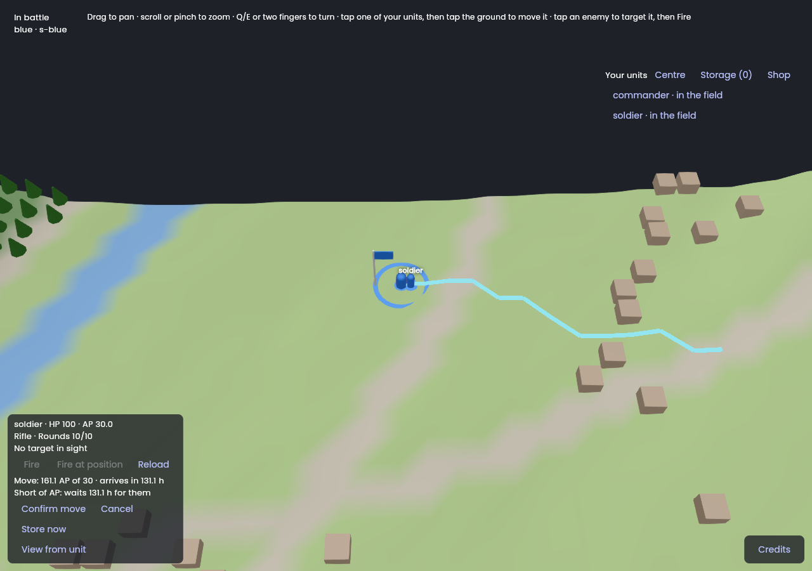
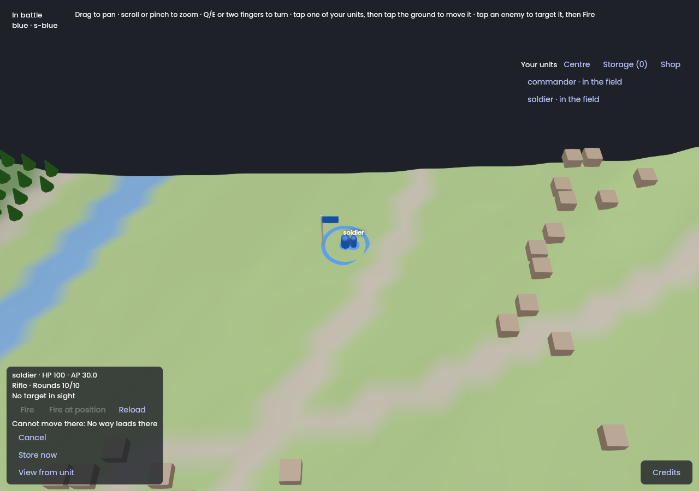
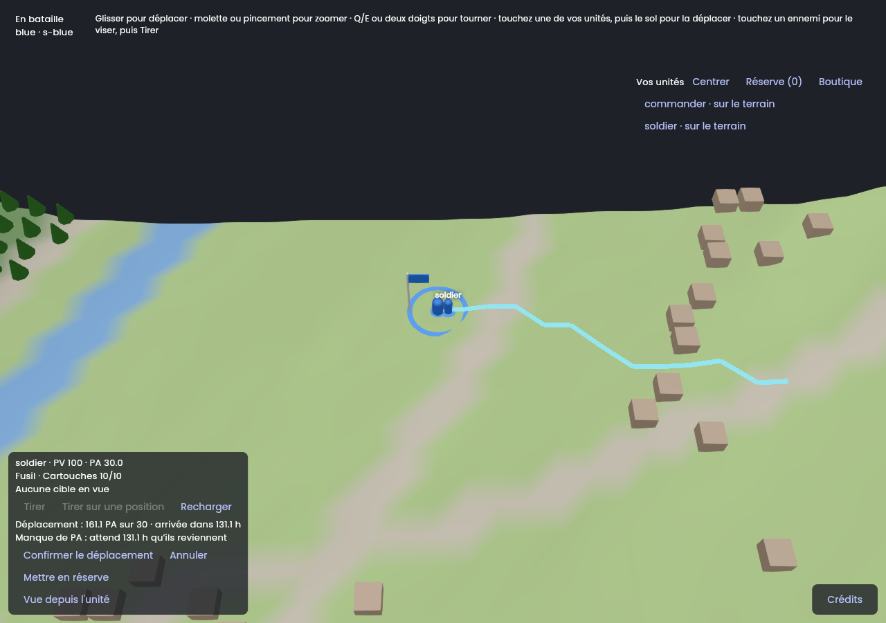

# Session M7.8: Move: path preview and AP cost

**Issue:** `apps/battle_team/plan/milestones/m7-client.md`, Issue 8. It is the specification of this session: read it entirely, with the milestone's "Conventions".
**Packages:** `packages/battle_client` (pre-check), `apps/battle_team` · **Branch:** `bt/m7-08-path-preview` · **Depends on:** M7.1 (M7.2 for fast manual runs).
**Skills:** `vgv-ai-flutter-plugin:testing`, `vgv-ai-flutter-plugin:green-gate`.
**Read** (`plan/` is `apps/battle_team/plan/`): COMBAT-03, COMBAT-06, MAP-20, MAP-47, MAP-50, `plan/specs/10-map-and-terrain.md` §3 and §4; decisions 169, 180, 236, 240; `plan/stack/08-workload-placement.md`; `plan/data/terrain.yaml` (`ap_multiplier`, slopes), `plan/data/units.yaml` (`ap_per_m`, movement classes); the session logs of M3.3 (unit paths, path check), M3.6 (long paths, search data), M4.4 (movement cost), M6.7 (the pre-check was deferred here), M7.1.

## Steps
1. **Where the map is**: the app loads `saint_lo_1km`'s built tiles (`battle_map`, `lib/battle/map_assets.dart`). `battle_pathfinding` builds its `NavigationMap` from the same tiles (M3.2, M5.8): check the loader exposes what the client has; if it needs the full map in memory, note the cost (P-06, M7.13).
2. **Pre-check port in `battle_client`**: `MovePreview previewMove(unitId, destination)` → path points, AP cost, arrival time, or a `MoveRefusal` (unreachable, occupied by a seen unit — MAP-50, cutting corners — MAP-47). Implemented on `battle_pathfinding` + `battle_rules` behind a port (`PathPlanner`), so tests inject a fake and the app injects the real one. Display only: the doc comment says the host decides.
3. **UI**: on tapping the ground with a unit selected, draw the preview (a line through the `BattleWorld` seam: `showPath(points)`, `FakeWorld` records it) with the AP cost against the unit's AP and, when AP run short, the wait COMBAT-06 implies; a Confirm button sends `Move`; a refused preview shows why and sends nothing. A seen occupant at the destination shows "occupied" (MAP-50); unseen ones are unknown to the client by design.
4. **Divergence**: when the host refuses or replies with another arrival, the UI shows the host's answer and drops the preview; it never argues.
5. **Scripted checks**: grass, slope, road, water (boat vs. foot), a wall corner, an occupied cell: the preview's cost and refusal match what `battle_host` answers for the same order (reuse the host's test map or the recorded streams; where the host's answer is not available in a recording, run the host's rules in the test).
6. **Gates** (§4, §6) for `battle_client` and the app; **show it** (recording: a long preview, a refused one); **finish** (§5): `battle_client` PR first.

## Tests to write
- `COMBAT-03 preview cost equals ap_per_m × terrain × slope along the path` (real data, fixture map).
- `MAP-47 a path never cuts a wall's corner`; `MAP-50 a destination held by a seen unit is refused before sending`.
- `COMBAT-06 a cost above the AP shows the wait at the recovery delay`.
- `decision 236 the unit glides to its arrival time after confirmation` (already in M7.1's tests; extend).
- Widget tests: confirm/cancel, cost label (en, fr), refusal label.

## Stop and ask when
- The client cannot build the navigation model from the assets it has (memory or missing data): ask whether to download a prepared model or defer the preview to the host (a `PreviewMove` request would be a protocol change).

## Pitfalls
- `battle_pathfinding` is pure Dart and may be slow on a 1 km map in debug: measure once and write the number in the log; do not optimise in this session.
- Two sources of truth for movement cost are forbidden: call `battle_rules`, copy no table.

## Acceptance criteria
- [x] The acceptance criteria of the issue (m7-client.md, Issue 8): the preview's cost and arrival equal the host's on scripted cases (grass, bridge, road, wall and building, river, AP short, off the map, flying), and pictures in the log. **A picture, not a recording**; not on the playtest battle (see the log).
- [x] The definition of done (`docs/battle_team/agent-workflow.md` §4 and §6).

## Session log

**Built** (2026-11-10, branch `bt/m7-08-path-preview` from `main` in hawkbee, `battle_client`, `battle_host` (a test only) and `battle_team`; M7.7 was merged by then):
- **`battle_client`** (new dependency `battle_pathfinding`): `PathPlanner`, the port (`cellAt`, `pointOf`, `find`; Strategy), and `NavigationPathPlanner`, its real implementation on a `NavigationMap` and `TerrainData`: the cell under a position by the host's own rule (a floating island when nearer its surface), the ground search (`GroundSearch.fast`) for a mover on the ground and the general `Pathfinder` otherwise, exactly as `command_handler._route` does, with `PathRules` as `SharedMap` makes them. `MovePreviewer.preview(unit, destination, seen, time)` gives a sealed `MovePlan`: `MovePreview` (the `Cell` path for the order, the points to draw, `costAp`, `lengthM`, `arrivesAt` on the battle clock, `apWait`), `MoveRefused(PreCheckRefusal)` or `MoveUnplanned` (a unit type its data does not know: the host decides). The price is `MovementCost.move` of `battle_rules` on the unit's own AP pool: no table copied, and no cost computed here. `PreCheckRefusal` gained `off_map`, `no_path` (the host's codes) and `occupied` (the client's own: the host does not enforce MAP-50 yet, M8 topic 6).
- **`battle_host`** (test only, `test/src/orders/move_preview_test.dart`): the previewer on the host's own navigation model of the valley, against the host's answer to the same order in a fresh battle: the same `MoveStarted.arrivesAt` for the order without a path, and for the order sent with the previewer's `Move.path` (the host checks it cell by cell and accepts it), and the same refusal code where it refuses.
- **App**: `loadMovePreview` (the built map files, `plan/data/terrain.yaml` bundled as an asset, `HostMapLoader` of `battle_map`, the same loader the host uses: MAP-05); `loadBuiltMapAsset` shared with `loadMapAsset`. `BattleCubit(movePreviewer:)`: `previewMoveTo` keeps a `PendingMove` (unit, where it stood, the plan) in the state and sends nothing; `confirmMove` sends `Move(to, path)`; `cancelMove`; Escape cancels before it clears the selection; selecting another unit, or the unit moving or leaving, drops it. `moveSelectedTo` stays the immediate order (first person: a step of a stream, stack decision 3), now with the planned path and the pre-check's refusal. `BattleWorld.showPath(points)` (`FakeWorld.path` records it; `SceneBattleWorld` draws a line of thin cuboids on the ground). `MovePanel` in the selected unit's panel: `Move: 35.4 AP of 30 · arrives in 5.4 h`, `Short of AP: waits 5.4 h for them`, Confirm and Cancel; or `Cannot move there: <reason>` with Cancel only. l10n en + fr (`move*`, `no_path`, `off_map`, `occupied`).
- **Divergence** (stack decision 8): after a confirmed move the cubit waits for the host's end of move (`UnitPrivate.movingUntil`, which is the host's `MoveStarted.arrivesAt`) and, if it differs from the preview's by more than a second, says so (`ArrivalNote`, `The host has the unit arrive 5 min later than previewed`); a refusal shows as the host's and the preview is already gone. It never argues.

**Checks**: format and `dart analyze --fatal-infos` clean in the three; `battle_client` 192 tests, `battle_host` 432 (the whole suite, 9 new), the app 349, **100 % line coverage** in `battle_client` and the app, `optimization: false`. Rules and tests: COMBAT-03 (grass at `ap_per_m`; uphill and downhill by the class's slope factor and floor, MAP-16; road 0.7 foot and 0.4 wheeled at the jeep's own 0.1; MAP-41 each terrain for the distance on it; a bridge deck as road, MAP-42; a boat on water with the sail multiplier, MAP-19; a flying unit at the altitude limit, MAP-17), MAP-47 and MAP-44 (a path round a wall, never across its corner, 40 AP and the exact five cells; walls that close the way: no path), MAP-50 (a destination whose width other seen units use up: refused, friend or enemy; a soldier beside soldiers is free; the mover's own place is its own; flying units apart; an unseen unit gives no clue, decision 237), COMBAT-06 and MAP-20 (a cost above the AP: the wait at the recovery delay, 1 AP an hour against 1 a second), decision 236 (the unit's end of move after the order is the preview's arrival), stack decision 8 (the order carries the path, a refusal shows as the host's, an arrival that differs is told once), widget tests in en and fr, a screen reader's labels.

**Measured** (once, debug VM of `flutter test`, saint_lo_1km, 100 × 100 cells of 10 m): loading the navigation model from the bundled files 0.35 s; the first search (which also prepares the shared grid) 22 ms, a 30-cell path 11 ms, the same again under 8 ms. Nothing optimised; the web build is M7.13's to measure. The map is read twice (the mesh and the navigation model); `loadBuiltMapAsset` returns the files once more instead of sharing them, to keep the two loaders independent.

**Choices and deviations**
1. **`MovePreviewer` is a class beside `OrderPreCheck`, not a method of it**: the pre-check needs the plan's terrain tables and a map the other orders do not, and `OrderPreCheck`'s constructor is in every test. The cubit takes it as an optional `movePreviewer`; without one a move goes straight to the host, as before (all earlier cubit tests are unchanged).
2. **A tap from above previews; from a unit's eyes it goes at once.** The issue says a tap draws the preview and Confirm sends; a first-person move is a step of a stream (5 a second in stack/03) and a confirm per step would break it. It still gets the planned path and the pre-check's refusal.
3. **The preview knows the map as built.** Structures built and destroyed in the battle, and craters (the delta layer, `HeldView.world`) are not applied to the navigation model: after one a preview can differ from the host's answer, which wins and shows. Applying them is `battle_host`'s `world_changes.dart` (240 lines) on the client's map: a session of its own (M9 or M8), not a rule question.
4. **MAP-50 is checked by the client alone** and only for the destination's cell, with the 10 m cell width (a bridge's `width_m` is in `terrain.yaml` but `battle_rules` does not read it yet) and the hit boxes of `units.yaml`. The host does not refuse a taken place yet (M8 topic 6), so a preview refused as `occupied` is a move the host would accept: the code `occupied` is the client's, and the host's own will replace it. Crossing a taken cell is not checked.
5. **The preview's AP and arrival are of the moment it was made**: AP recover while the player looks at it. The panel shows the unit's AP now beside the cost, and the host's arrival is told after the order if it differs.
6. A move the host refuses for a weapon that cannot move loaded (`weapon_loaded`) or an observing unit (`observing`) is not pre-checked: the host's refusal shows.
7. `PathRules` are built in `NavigationPathPlanner` as `SharedMap.load` builds them (the road construction `road_segment`, the altitude limit): two copies of 15 lines, kept equal by the parity test on the valley. Moving them into `battle_pathfinding` is a refactor of three packages, not done here.

**Found, not fixed**
- `dart analyze` of the whole `battle_host` package still reports errors in the stale `build/docker/src` (M7.7's log); `lib` and `test` are clean.
- The path line is drawn from cell centre to cell centre, units are drawn three times their size: from low zoom the line seems to start beside the unit. Cosmetic.

**Not done, and why**
- **No recording, and not on the playtest battle.** The pictures are from a web build over an in-memory host with the real map and the real preview, for the reasons of M7.5's log. A recording needs the unit to move: the in-memory host does not move units, so the glide after a confirmation is shown by the tests (the end of move of the host's view equals the preview's arrival), not on screen. **To do on the owner's side**: run the development flavor against the playtest host, select a soldier, tap the ground (a long preview, then the river), confirm, and watch it walk; paste a recording here.
- The scripted checks of grass, slope, road, water, a wall corner and an occupied cell run in `battle_client` on fixture maps (exact costs) and in `battle_host` against the host (the valley: grass, bridge, road, wall and building, river, AP short, off the map, flying); a slope and a taken place are not in the valley (flat, no crowd), so they are checked on exact costs only.

**Pictures** (web build, headless Chromium, software WebGL; I looked at each one; the real `App`, the real map `saint_lo_1km`, a scripted in-memory host: a commander and a soldier with 30 AP at the HQ):

| A long preview: the path takes the road round the houses; 161 AP for 30 held, 131 h of waiting | The river: no way leads there, nothing to confirm |
|---|---|
|  |  |

| French: the same preview |
|---|
|  |
