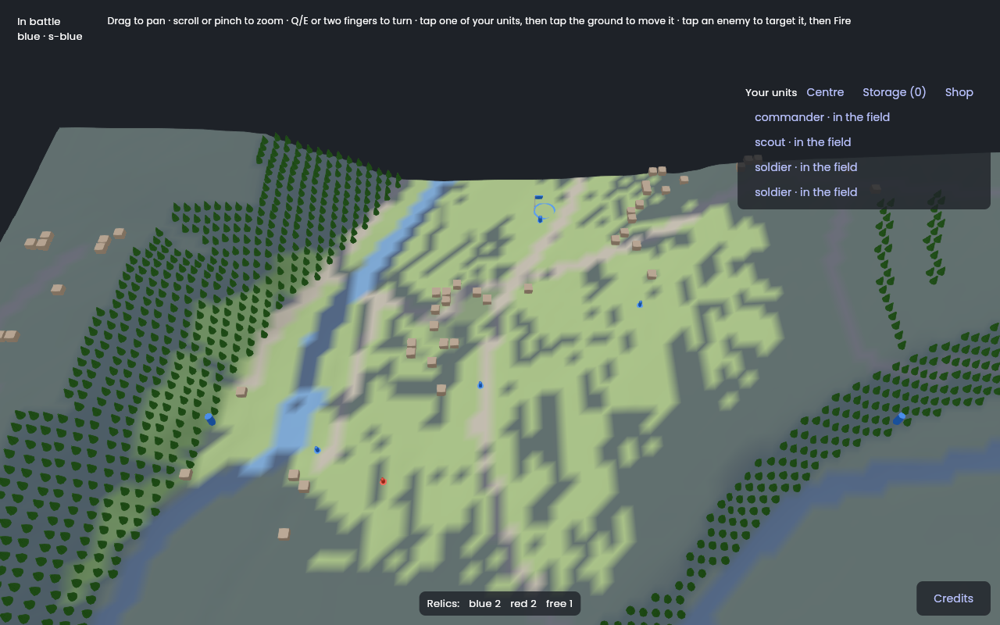
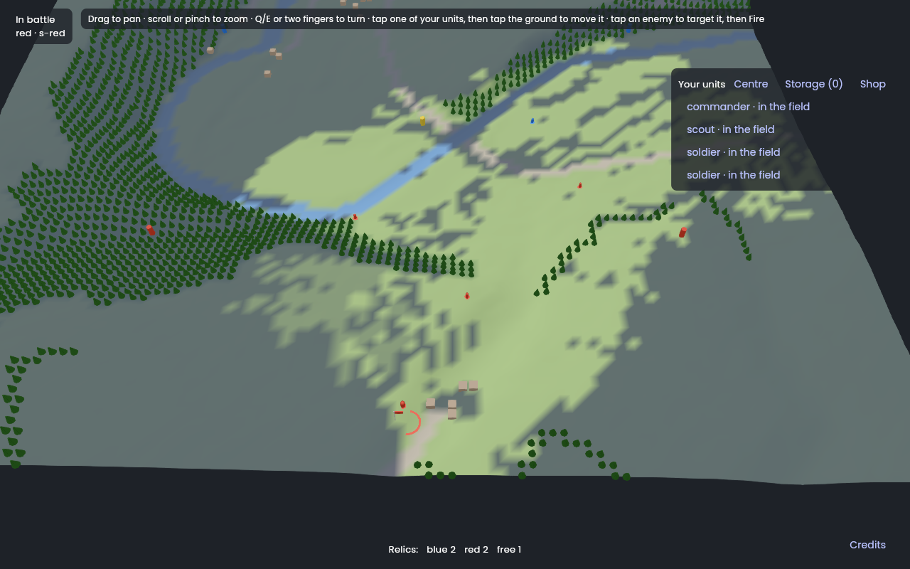
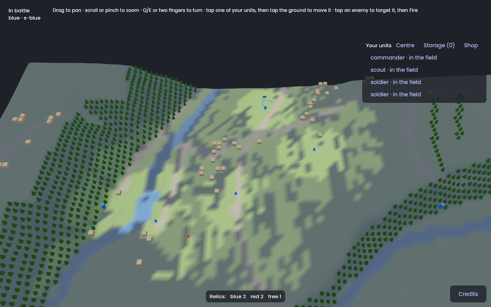
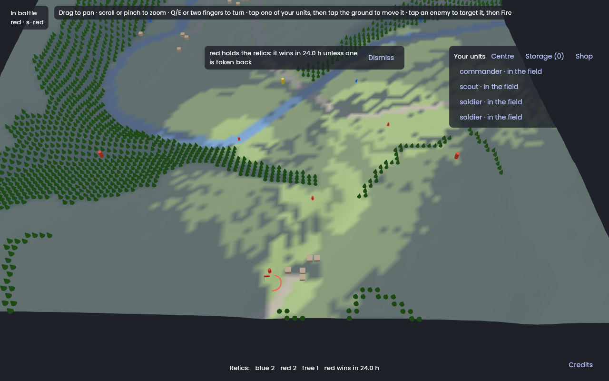
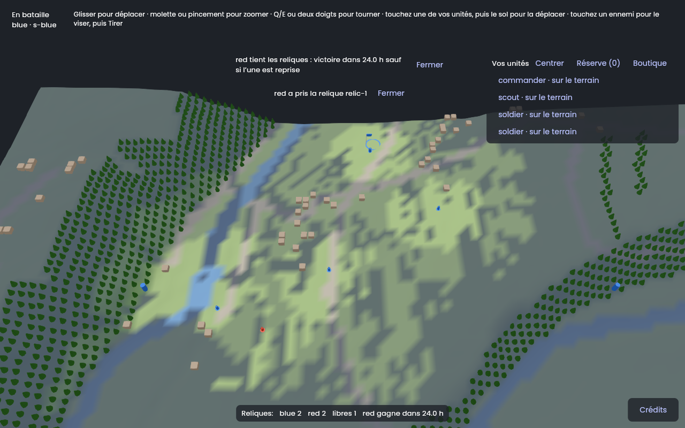

# Session M7.9: Fog shading and alerts

**Issue:** `apps/battle_team/plan/milestones/m7-client.md`, Issue 9. It is the specification of this session: read it entirely, with the milestone's "Conventions".
**Packages:** `packages/battle_protocol`, `packages/battle_host`, `packages/battle_client`, `apps/battle_team` · **Branch:** `bt/m7-09-fog` · **Depends on:** M7.4.
**Skills:** `vgv-ai-flutter-plugin:testing`, `vgv-ai-flutter-plugin:green-gate`; read `packages/flutter_scene/MATERIALS.md` and the `flutter_scene-procedural` skill (`packages/flutter_scene/packages/flutter_scene/skills/`) for a custom ground material.
**Read** (`plan/` is `apps/battle_team/plan/`): MAP-27, MAP-29, MAP-33, MAP-49; RELIC-10, RELIC-16; decisions 21, 232, 233, 235, 237; `battle_protocol` `messages.dart` (what a `SectionView`/`TickUpdate` says about sight: units in and out, alerts, the countdown); the session logs of M6.3 (what the host computes: the visible set, never sent as an area) and M6.4 (alerts, late delivery), M7.4.

## What the client knows, and what it must be sent
The host sends **units** in and out of sight, never a visibility area (M6.3/M6.4). Fog shading needs the area, and sight depends on the terrain (MAP-26, decision 235): the client therefore runs `battle_rules`' vision — the same code the host runs in `FogOfWar`/`SectionSight` (M6.3, `battle_rules`' `GroundObstacle`) — over the map heights it already holds for the mesh, **for display only** (stack decision 8). Its inputs are the section's **own** units only: their positions (in the view) plus two things the view lacks today and this session adds under M6's conventions: each own unit's **effective sight range** (`UnitPrivate.sightRangeM`, after skills and observe) and the battle's **weather** (on `SectionView`, updated by `TickUpdate` when it changes). Nothing of other units feeds the shading (decision 237).

## Steps
1. **Protocol first** (`battle_protocol` → `battle_host` → `battle_client`): `UnitPrivate.sightRangeM` and the weather on `SectionView`/`TickUpdate`; frozen samples, both encodings, sizes next to `stack/03`; the host fills them from the effective stats it already computes (M5.1, M6.3). Read M6.2's log for the procedure.
2. **Fog model** in the battle feature (pure Dart, tested): `FogModel` with `isLit(x, y)` computed on a coarse grid (one 10 m cell, stack decision 5) by `battle_rules`' vision from each own unit (position, `sightRangeM`, the weather, the terrain heights from the loaded tiles). Recompute only when an own unit moves, its range or the weather changes. Three states per cell: lit now, seen once (kept for the session), never seen.
3. **Ground shading** through the `BattleWorld` seam: `showFog(FogModel)`; `FakeWorld` records it; the GPU class renders it as a ground overlay or material parameter (coarse texture updated on change, not per frame). Units out of sight already vanish (M7.1 test).
4. **Alerts**: a bloc listening to alert messages: the relic alert (RELIC-10, also delivered on connect — decision 233) and the victory countdown (RELIC-16); MAP-49's facts (relic owners, countdown) shown permanently in a status strip. Alerts appear as a dismissible banner, localized en + fr.
5. **Decision 237 proof**: a bloc test over a recorded stream: the fog model lights only around own units; an unseen hit lights nothing; an enemy leaving sight leaves no mark.
6. **Gates** (§4, §6) for the four packages; **show it** (recording with two sections' views — run two clients on the fake host or two accounts on the playtest battle); **finish** (§5): protocol, host, client PRs first.

## Tests to write
- `MAP-26 / decision 235 a hill between an own unit and a cell leaves it dark` (fixture heights); `MAP-27 the fog model lights the own units' sight ranges`; `MAP-29 nothing outside the lit area is drawn`; `MAP-33 seen-once differs from never-seen`.
- `RELIC-10 / decision 233 the relic alert shows once, also when received on connect`; `RELIC-16 the countdown shows for every section`; `MAP-49 relic owners show whatever the fog`.
- `decision 237 fog gives no clue about unseen units or hits`.
- `M7.9 the client's lit cells equal the host's visible set` on M5.15's scripted battle (own units' sight only, both sides).
- Widget tests: banner, status strip, en and fr.

## Stop and ask when
- The vision computation over the whole 1 km map is too slow in the app (measure once): propose the host sending a visibility mask instead (traffic cost on big maps) and ask; do not ship a slow frame.
- The host's `FogOfWar` and the client's model disagree on the scripted battle: find why (same code, same inputs: they must agree); if the host's inputs are richer than what the view sends, ask what else to send.

## Pitfalls
- The fog grid is view state, not game state: never send it, never log it.
- Update the fog texture when the model changes, not every frame (frame budget, stack decision 4).

## Acceptance criteria
- [ ] The acceptance criteria of the issue (m7-client.md, Issue 9).
- [ ] The definition of done (`docs/battle_team/agent-workflow.md` §4 and §6).

## Session log

**Built** (2026-11-11, branch `bt/m7-09-fog` from `main` in hawkbee, `battle_protocol`, `battle_host`, `battle_client` and `battle_team`; M7.8 was merged by then):
- **`battle_protocol`**: `UnitPrivate.sightRangeM` (the unit's vision range after its skills, plus the observe bonus while it observes), `SectionView.weather` (required) and `TickUpdate.weather` (only when it changed). Both encodings; the host message samples were **rewritten** (as `4c49edf` did for `team`: version 1 is not deployed yet) and a sample `tick_weather_changed` added; `tool/message_sizes.dart` prints it.
- **`battle_host`**: `SectionViews` fills the range from the same values `FogOfWar` computes with (`unit.type.stats.visionRange`, which the skills already evolved, plus `observation.bonusAt(time)`), and the weather; `UpdateStream` sends the weather when it differs from the last one sent (`_Sent.weather`); an observation starting or ending reaches the section through the existing own-unit-changed path. Tests: `update_stream_test.dart` (range, observe bonus in and out, weather once), and **`client_fog_test.dart`: the client's lit cells equal the host's** (below). `ViewHolder` keeps the weather.
- **`battle_client`**: `HeldView.weather` and `worldVersion`; **`GroundSight`** (`lib/src/sight/`): the ground a unit sees, `battle_rules`' `Vision` over the navigation model with the sight line of `World.sightLine` (hill, building, mountain, wood, height bonus, flyers); `seenFrom(...)` gives the cells one unit sees, `withWorld(...)` applies the delta layer the host sent (walls built, trees and buildings destroyed, craters), `cellUnder` is the host's cell-under-a-position rule, shared with `NavigationPathPlanner`. The recorded streams were recorded again (new format).
- **App** (`lib/fog/`, `lib/alerts/`, the battle feature): `FogModel` (immutable; `never` / `seen` / `lit` per 10 m cell, `lighting(...)` makes the next one), `FogTracker` (pure; from the section's own units, `sightRangeM`, the weather and the delta layer; recomputes only a unit that moved or changed range, and all of them when the weather or the delta layer changes), `FogCubit` (emits only when the ground in sight changes), `fogShadedColors` (pure: lit as is, seen once at 55 %, never seen at 18 % of the ground colour, towards a dark tint). `BattleWorld.showFog(FogModel)`: `FakeWorld` records it, `SceneBattleWorld` makes the ground mesh again with the shaded vertex colours when the fog changes (`Node.mesh` setter), never per frame. `AlertsCubit` (the repository's new `alerts` stream of `RelicAlert`, and the snapshots): a banner per relic alert, shown once (the key is time, relic and team: the host may send one twice after a crash, M6.4), and per countdown that starts (also when the player connects to a running one), is taken over by another team, or is reset; `StatusStrip` (relic owners and the countdown, counting down by the battle time of the client) and `AlertBanners` (Dismiss). `BattleSnapshot` gained `weather`, `world`, `worldVersion`, `hold`. English and French. `BattlePage` provides the two cubits first and not lazily; `loadGroundSight` reads the map a third time (mesh, preview, sight), as M7.8 did for the preview.
- Docs: `plan/stack/03-networking.md` (sizes, what the client computes), `agent-workflow.md` §6 (the fog seam).

**Checks**: format and `dart analyze --fatal-infos` clean in the four. Tests (test optimization off), **100 % line coverage** in all four: `battle_protocol` 751 (+3), `battle_host` 441 (+9), `battle_client` 211 (+19), the app 413 (+64). Rules and tests: MAP-26 and decision 235 (a hill, a building, a mountain between an own unit and a cell leaves it dark; the hill itself lit; a flyer's line passes over: `ground_sight_test.dart`, `fog_tracker_test.dart`), MAP-27 (the fog lights the own units' ranges; each metre of forest shortens the sight), MAP-31 (weather factor, a change of weather), MAP-33 (seen once differs from never seen: `fog_model_test.dart`, `fog_cubit_test.dart`; the height bonus), MAP-29 (the sights of the section's units add up; **nothing outside the lit area is drawn**, over the four recorded streams on the real valley), MAP-49 (relic owners and the countdown in the strip whatever the fog), RELIC-10 and decision 233 (the relic alert shows once, also when received on connect, and twice-sent), RELIC-16 (the countdown shows for every section, counts down, reset and takeover are alerts), decision 237 (`fog_over_the_stream_test.dart`: on recorded streams the fog lights only around the own units at every message; an unseen hit, a shot of a unit seen at a target not seen and an enemy that leaves sight change nothing and leave no mark; the logs name no unit), MAP-06 to MAP-09 and MAP-28 (a wall built stops the sight behind it, destroyed it stops blocking, a crater lowers the ground), widget tests of banner and strip in English and French, and **M7.9 the client's lit cells equal the host's visible set**: on M5.15's scripted battle (clear and fog, both sections, own units' sight only, at every one of its 42 steps) and on the plain map (a wood, a ridge, a building) in the four weathers, the cells `GroundSight` lights from what the host sent equal what `FogOfWar.seesGround` says for each own unit.

**Sizes** (`stack/03`, binary): a tick with nothing but its time 21 B (was 20: the weather's flag), a tick that changes the weather 25 B, the whole view of a 16-unit section 2,516 B (was 2,383; 6,474 in JSON), 8 B more for each own unit sent whole (the range). The fight totals stay under 12 kbit/s down.

**Measured** (once, `dart run` in the container's VM, `saint_lo_1km`, 100 × 100 cells of 10 m; not a device): loading the map 123 ms (it is read once more than the mesh needs). `GroundSight.seenFrom`, a unit alone: first cut 3 to 9 ms for a soldier (range 150), 29 ms for a scout (300) in the middle of the map, 112 ms for 16 soldiers at once; after skipping the cells out of reach before building their line and keeping only the blocking obstacles on it (same lit cells, 4 to 10 times faster): **0.3 to 4 ms a soldier, 0.5 to 6.7 ms a scout in clear weather, 18 ms for 16 soldiers**. A unit costs that only when it moves to another cell or its range changes; the weather or a change of the delta layer recomputes every unit (about 18 ms for 16). The stop rule (a slow frame, ask for a host mask) did not trigger; a phone is M7.13's to measure, with the remeshing of the ground (10,000 vertices, 60,000 indices) which was not timed.

**Choices and deviations**
1. **The client applies the delta layer to its sight** (`GroundSight.withWorld`). The parity test found the reason the issue's stop rule suspected: after the wall is built (`wall@(3, 4)`, in the script) the client lit cells the host does not, because the host's world holds the wall. No new data to send: the client already holds the delta layer; `battle_pathfinding`'s `applyChange` does the rest, for what a sight line reads (a wall or trap that blocks, trees and buildings destroyed, craters). Bridges, roads and ladders change no sight line. The move preview (M7.8) still plans on the map as built.
2. **Version 1 samples rewritten**, not frozen: a field added to an existing message cannot keep the old bytes. Same precedent as `4c49edf` (a unit seen shows its team). Nothing runs version 1 yet.
3. **Own units' sight only**, as the issue says: an ally's sight and a scout relayed through a radio (MAP-29, decision 232) do not light the ground, so a unit seen that way can stand on ground that stays dark. The recorded streams hold no such unit (each section's units are its own).
4. **The shading is the ground's vertex colours**, remade when the fog changes, not a texture or a material parameter: the ground is one vertex per cell, so the edge of the light is soft over 10 m. A texture is a swap behind `showFog` if M7.13 prefers it.
5. **Seen once is kept for the session, in the app**: a restart forgets it, and the host knows nothing of it (decision 237: the grid is never sent nor logged). Trees and buildings in ground never seen stay drawn: the map is known to all (MAP-49), only units are hidden.
6. **The host never changes the weather yet** (`Battle` starts on the first state of `weather.states`; the random change of MAP-31 is not built), so the stream's weather update is proven with a changed state in the tests, not by a battle.
7. **Banners**: the relic alert (RELIC-10) comes only to the team that lost the relic (host), the countdown (RELIC-16) to every section. A countdown banner says the time left when it was announced; the strip counts down.

**Found, not fixed**
- `dart analyze` of the whole `battle_host` package still reports errors in the stale `build/docker/src` (M7.7's log); `lib` and `test` are clean.
- The banners are centred at the top and the strip at the bottom; on a narrow phone they can overlap the panels at the sides. Not seen on a phone.

**Not done, and why**
- **No recording on a phone, and not on the playtest battle**: the pictures are a web build, headless Chromium with software WebGL (the recipe of §6), over a **throwaway in-memory host** (not committed) with the real `BattlePage`, the real map `saint_lo_1km` and the real fog, one section per run (`?section=blue` or `red`): each has four units, sees one unit of the other, and receives scripted updates (a soldier moves 10 s in, the weather turns to fog at 20 s, a countdown starts and, for blue, a relic alert comes at 30 s). The numbers (positions, ranges) are the script's, not the rules'. **To do on the owner's side**: run the development flavor with two accounts on the playtest battle (`playtest.md`), watch both sections and move a unit; paste a recording here.

**Pictures** (I looked at each one):

| Blue section: lit around its units, an enemy seen at the lower left, the rest never seen | Red section, same battle: the lit ground is in the south, and a blue unit is seen at the top |
|---|---|
|  |  |

| Blue, in fog: the light shrinks (range × 0.4), the ground it left is dimmed (seen once) | Red, in fog, after a soldier moved: its trail is seen once; the countdown banner and the strip |
|---|---|
|  |  |

| Blue in French: the relic alert, the countdown banner (Fermer), the strip |
|---|
|  |
