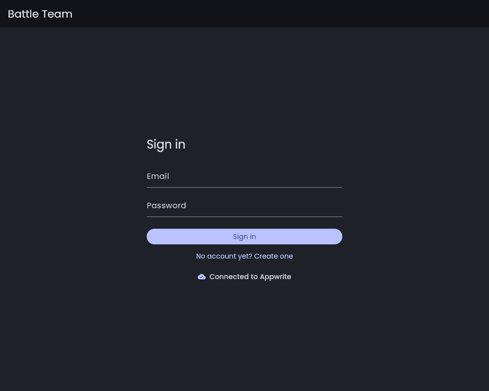
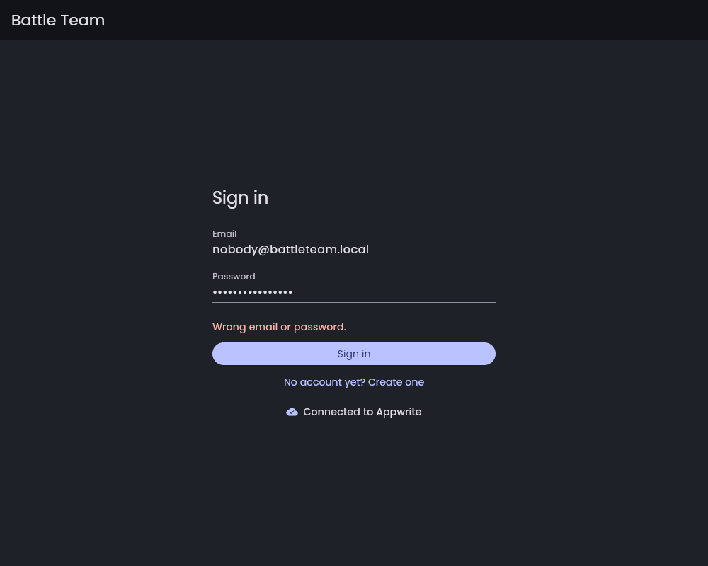
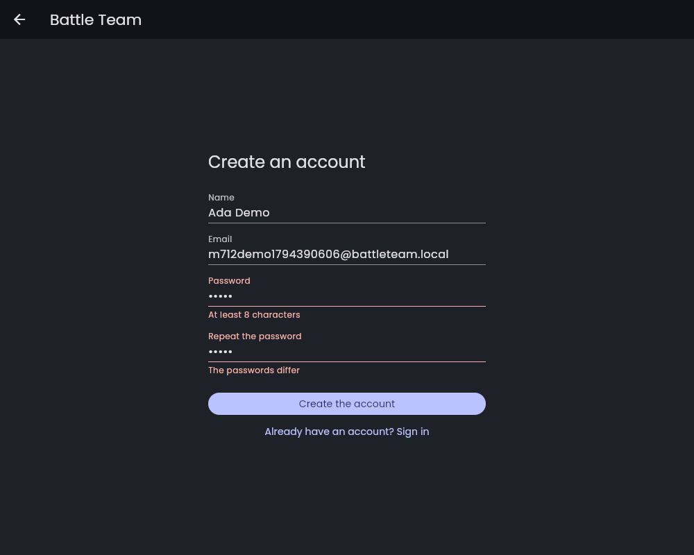
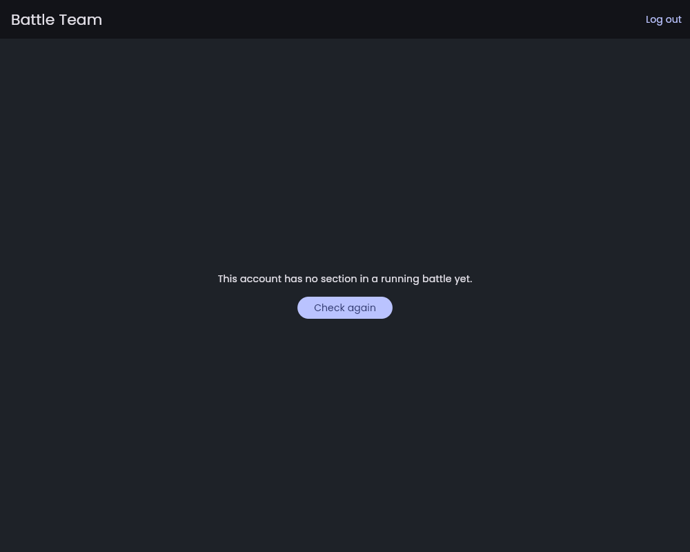
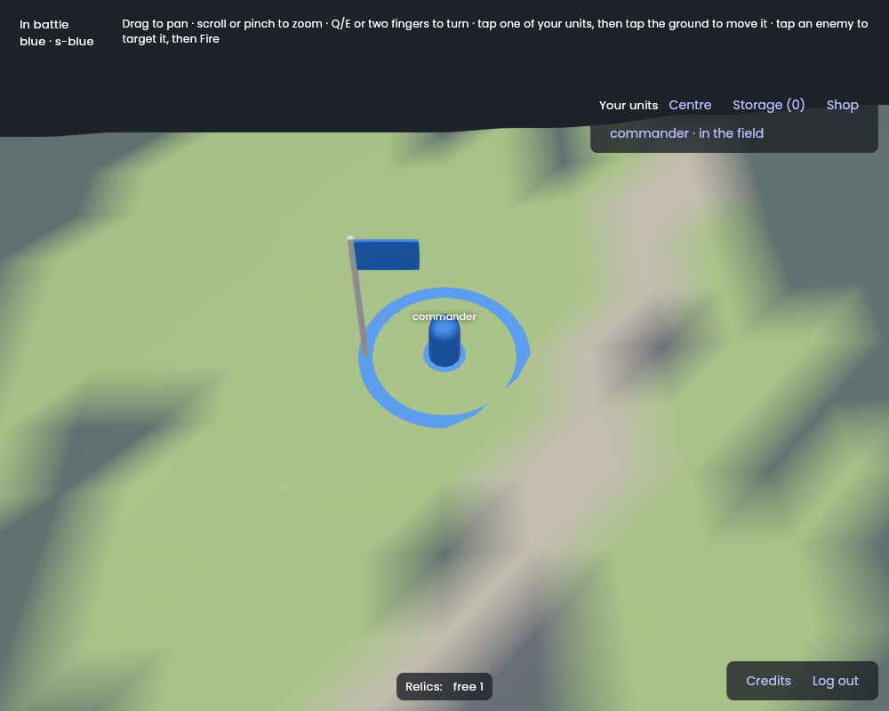
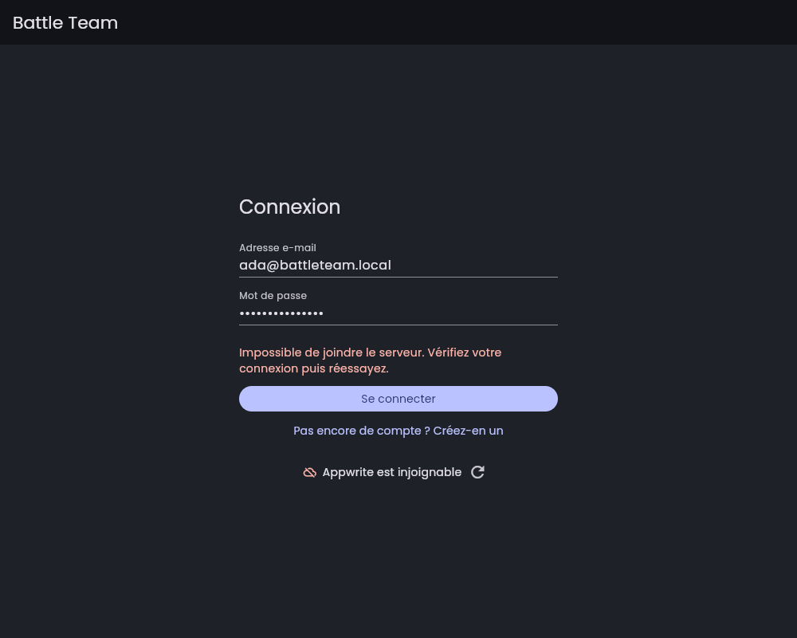
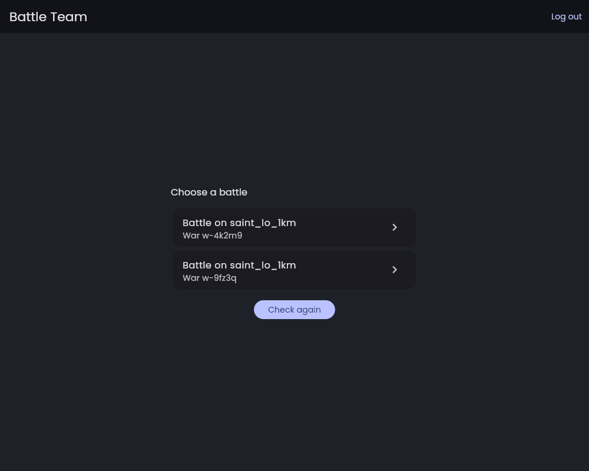
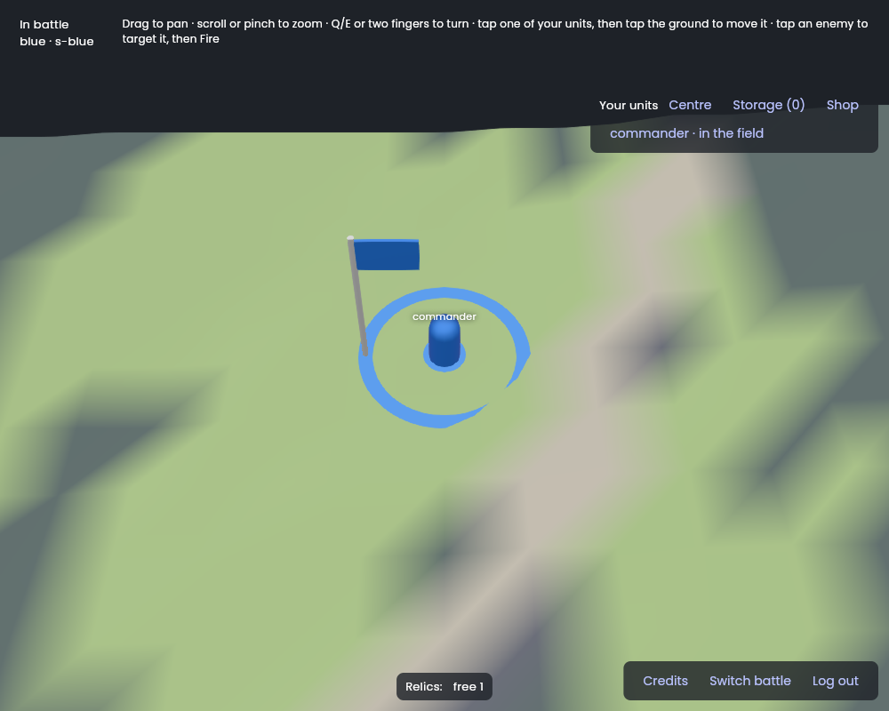
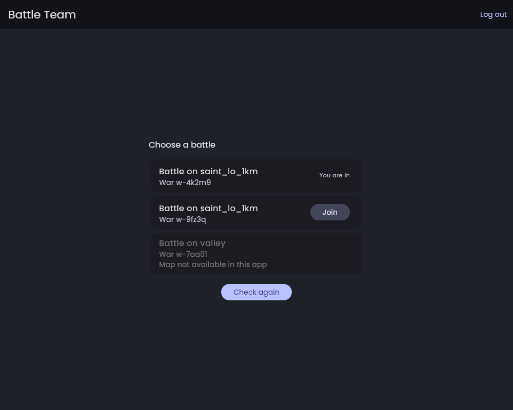
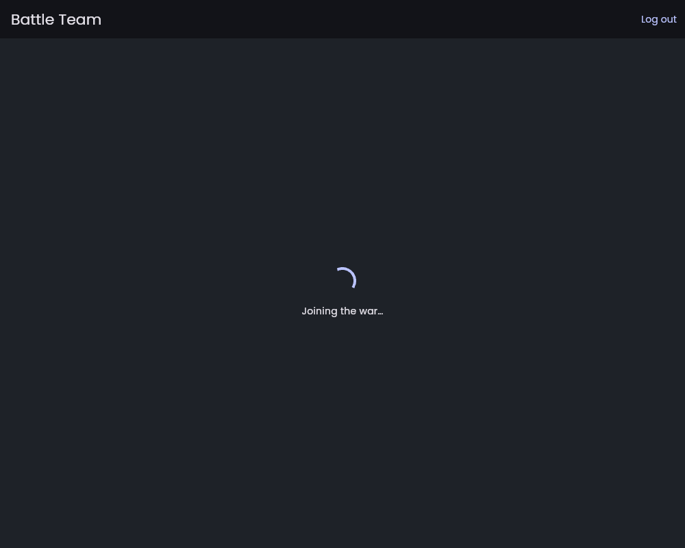

# Session M7.12: Accounts: sign up, sign in, log out

**Issue:** `apps/battle_team/plan/milestones/m7-client.md`, Issue 12. It is the specification of this session: read it entirely, with the milestone's "Conventions".
**Packages:** `apps/battle_team`, `packages/appwrite_api_client` (in hawkbee itself) · **Branch:** `bt/m7-12-accounts` · **Depends on:** M7.1.
**Skills:** `vgv-ai-flutter-plugin:bloc`, `vgv-ai-flutter-plugin:static-security`, `vgv-ai-flutter-plugin:testing`, `vgv-ai-flutter-plugin:green-gate`, `appwrite:dart`.
**Read** (`plan/` is `apps/battle_team/plan/`): decisions 126, 220; `plan/stack/06-accounts-and-services.md`; `docs/project-setup.md` (local Appwrite, `env/development.json`); `packages/appwrite_api_client/lib/src/appwrite_api_client.dart` (`signIn`, `createJwt`, `selfSigned`); `packages/hawkbee_schema` (the `bt_sections`/`bt_battles` rows a player may read); the session logs of M5.18 (Appwrite data), M6.5 (sign-in is `EnterBattle`, host-side), M6.6 (host lookup), M7.1 (the `env/` sign-in to replace).

## Steps
1. **`appwrite_api_client`**: `signUp(email, password, name)` (`account.create` + session), `currentAccount()` (null when none), `signOut()` (`deleteSession('current')`); failures as typed exceptions as `signIn` does. Tests with the mocked `Client`/`Account` as the existing ones.
2. **Authentication feature** (`lib/authentication/`): `AuthenticationRepository` over `appwrite_api_client` (status stream: unknown → unauthenticated/authenticated); `SignInPage`, `SignUpPage` (email, password, confirm; validation with `formz` or plain validators — static-security skill: no password in logs or state dumps); a log-out action in the battle screen's menu.
3. **Routing**: `App` shows sign-in until authenticated, then the battle. Session kept across restarts: the Appwrite SDK keeps its cookie jar; `currentAccount()` at start decides the first screen.
4. **Which battle**: after sign-in, find the account's section and its battle in Appwrite (the rows M5.18/M5.21 define; the playtest tool writes them). The `env/` sign-in stays for `main_playtest.dart` only; the normal flavors drop it.
5. **Errors**: wrong password, existing email, unreachable Appwrite, each a localized message (en + fr); no technical text to the user.
6. **Gates** (§4, §6); **show it** (recording on the owner's phone: sign up → battle → log out → sign in; or a web build); **finish** (§5): hawkbee PR carries `appwrite_api_client`.

## Tests to write
- `appwrite_api_client`: `signUp`, `currentAccount`, `signOut` success and failure (mocked SDK).
- `AuthenticationRepository` status transitions (bloc_test / stream matchers).
- Sign-in and sign-up pages: validation, submit, error display, en and fr; log-out returns to sign-in.
- `App` routing by status; `decision 220 the app sends no EnterBattle: the host logs the player in on the socket` (the repository exposes no such call).

## Stop and ask when
- Reading "the account's battle" needs a row or permission the local schema lacks: ask before changing `hawkbee_schema`/`battle_backend`.
- The owner wants social sign-in now (Discord, decision 126): it is a later session; ask only to confirm.

## Pitfalls
- Appwrite's session cookie needs https on phones (see hawkbee1/battle_team#38): keep `trustSelfSigned` for the development flavor against the local stack, never in production.
- Never store the password; the SDK holds the session.
- `appwrite_api_client` is the only package allowed to import `package:appwrite`.

## Acceptance criteria
- [ ] The acceptance criteria of the issue (m7-client.md, Issue 12).
- [ ] The definition of done (`docs/battle_team/agent-workflow.md` §4 and §6).

## Session log

**Built** (2026-11-11, branch `bt/m7-12-accounts` from `main` in hawkbee and `battle_team`; M7.1 and M7.9 were merged by then; `appwrite_api_client` lives in hawkbee, so there is no other repository):
- **`appwrite_api_client`**: `signUp(email, password, name)` (`account.create` with `ID.unique()`, then the session; a session still open is closed first), `currentAccount()` (an `AppwriteAccount` of ID, email and name, null on a 401), `signOut()` (`deleteSession('current')`, a 401 is already signed out), `findRows(databaseId, tableId, equal)` (the first 100 rows whose columns hold one of the values, as `AppwriteRow`, so the app never touches `package:appwrite`). Failures are typed as `signIn` did: `AppwriteSignInFailure` (sign-in, JWT), new `AppwriteAccountFailure` (sign-up, current account, sign-out) and `AppwriteRowsFailure`, each with a `kind` (`AppwriteFailureKind`: `invalidInput` 400, `unauthorized` 401, `conflict` 409, `tooManyRequests` 429, `serverError` 5xx, `unreachable` for no answer at all, `other`) read from the SDK's status code and passed to the constructor, so a caller can build one. Logs `sign-up`, `sign-out`, `current account`, `read rows` started / done / failed; never an email, a password or a name.
- **App, `lib/authentication/`**: `AuthenticationRepository` (status unknown → unauthenticated/authenticated, `restore()` at start, `signIn`, `signUp`, `signOut`; failures as `AuthenticationFailure` with an `AuthenticationFailureReason`: wrong credentials, account exists, invalid input, too many requests, unreachable, other; it never holds a password), `AuthenticationCubit` (the status for the whole app, `logOut(onFailure:)`), `AuthenticationFormCubit` (submits a form; its state holds **nothing typed**), `CredentialValidators` (plain, pure: email, password of 8 characters or more for a new account, name up to 128, confirmation), `AuthenticationGate` (sign-in page until authenticated, the battle after; pops the sign-up page by itself), `SignInPage`, `SignUpPage` (name, email, password, repeat), `LogOutButton`. Fields are masked, without suggestions or autocorrect, with autofill hints; a field is called wrong only after the first submit, then again as it is edited.
- **App, the battle**: `BattleLocator` (Strategy) with `AppwriteBattleLocator` (the account's `bt_sections`, then **every** `bt_battles` row of their wars with status `running` that has one of the sections in a team, as `AccountBattle` of war and battle; `hawkbee_schema`'s `SectionRow`/`BattleRow`, **no schema or backend change**) and `FixedBattleLocator` (the playtest's); `BattleEntryCubit` and `BattleEntryPage` (looks, **enters the only battle at once, lists several for the player to choose** (`Battle on <map>`, `War <id>`), or says there is none / why the search failed, with Check again and Log out; `choose()` lists them even when there is one); `BattleRepositoryFactory` (Factory: one `BattleRepository` per battle entered, closed with the battle). `BattleRepository` no longer signs in and `BattleCubit.start()` is `void`; `BattleStatus` loses `signingIn` and `failed` (the account is signed in before the battle exists; the initial status is `connecting`). The battle screen's bottom-right panel holds **Credits**, **Switch battle** (back to the list, which closes the battle's repository, then another war's battle can be entered) and **Log out**. `BattleSettings` is now where one battle is played (endpoint, project, battle, map); `PlaytestSettings` is the env file's account and battle.
- **App, the rest**: `App(authenticationRepository, backendStatusRepository, battleLocator, battleRepositoryFactory)`; `App.fromApiClient` (normal flavors) and `App.playtest` (signs in the account of `env/playtest.json` at start through `signInAtStart`, plays that one battle, the sign-in page only if that fails). `main_development.dart` now trusts the local stack's self-signed certificate like the playtest (the session's pitfall; staging and production never). `main_playtest.dart` falls back to the normal app when `env/playtest.json` is missing. The **title page is gone** (and `BattlePage.route()`, and `battleMissingSettings`): the sign-in page is the first screen and carries the backend indicator, which **no longer shows the reason** under it (it was the error text; the bloc observer still logs it). English and French for every string (`app_en.arb`, `app_fr.arb`).
- **Launch** (`.vscode/launch.json`): the development debug/profile/release entries no longer read `env/playtest.json` (they have no env sign-in any more); new **battle_team (phone)**: the normal app with `env/playtest.json` read last for the phone's LAN https endpoint.
- Docs: `agent-workflow.md` §6 (Accounts paragraph, the live-from-web recipe), `playtest.md`.

**Follow-up: Switch battle lists every battle and joins the ones the player is not in** (the owner's request after the first review, same branches; chosen "host late join first, then the app" when the gap below was shown to the owner).

The gap: `bt_create_war`'s `join` already creates the section (the war's starting money, a commander, the weakest team of the running battle, SOC-02/SOC-30/SOC-45), but a running host only seated the sections it loaded when the battle started, so a joiner got "no section" at the socket. The work, in the order of the layers:
- **`battle_protocol`** (new branch `bt/m7-12-accounts`): the order **`AdmitSection`** (team, money, units as `AdmittedUnit`), a new tag at the end of version 1 with its samples (`write_samples.dart` added them, no frozen sample changed). **69 B** binary as a stamped command (229 B JSON), once per newcomer, from the server only. 757 tests (was 751), 100 %.
- **`battle_host`** (new branch): `Battle.admit(SectionSetup, team:)`, sharing with `Battle.start` the construction of a section and its units (so a newcomer starts as at the battle's start: units in storage, full AP and HP, base morale, HQ-03/UNIT-31). `AdmitSection` goes through the order chain (it is logged with its sequence number, so a replay makes it again): the sender link checks the section and its account are **not** in the battle yet, one section per account (`section_exists`, `account_seated`), the team is in the battle and not out (`unknown_team`, `team_eliminated`); the right link says only the server may send it (`not_server`, as `EnterBattle`); the plan refuses an unknown unit type or a unit ID already used (`unknown_type`, `unit_exists`) and gives the event `SectionJoined`, which the statistics already read. `BattlePlacement.sync()` admits at each sync (10 s) the sections of a running battle's row that the battle does not have; a section that is not a new one (XP, a spare weapon, a tree step, unit XP, another weapon: an admission carries none of it) or an admission the battle refuses is **reported and tried again**, and a lost admission (a host recovered from an older log) is made again by the next sync. 470 tests (was 441), 100 %. **Two bugs the tests found in my first version**: `RightCheck` read the sender's section, which an admission does not have yet; and `UnitXp` has no value equality, so every newcomer was taken for "not a new one".
- **`battle_client`** (new branch): a sign-in refused for "no section" is asked for again after the backoff, up to `ClientSettings.seatRetries` (8, about a minute), counted again after each sign-in: the host admits a newcomer's section a few seconds after the backend created it. Other refusals still stop the client. 214 tests (was 211), 100 %.
- **`appwrite_api_client`**: `execute(functionId, body)` runs a function as the signed-in account (synchronously) and gives its status and JSON body (`AppwriteExecution`; a function that refuses is not a failure; `AppwriteExecutionFailure` when it cannot run). 46 tests (was 16 at the start), 100 %.
- **App**: `BattleLocator.locate` lists **every running battle** with `joined` (the account has a section in a team of it) and `join(warId)` runs `bt_create_war`'s `join` (`already_in_war` counts as joined; `war_over` and a server that does not answer are `BattleJoinFailure`s with words of their own). The entry page enters at once the only battle the account is in; otherwise it lists the battles: **You are in**, or **Join**, which asks first ("A new section is created for you in the war …, you enter its battle, you stay in its team for the whole battle": SOC-09 and SOC-45 make it permanent) and then shows "Joining the war…" and enters. **Switch battle** in the battle screen comes back to the list. A battle on a map the app does not have (it bundles `saint_lo_1km` only: `loadBundledMapIds` reads the asset manifest) is listed greyed out with "Map not available in this app": no join, no way in, and it is not entered at once either. 570 tests (was 537), 100 %.
- **`backend/`**: the vendored `battle_protocol` of the seven functions refreshed with `tool/vendor_packages.dart`. They were behind (the M7.7 roster and M7.9 weather too), and `bt_daily_stats` decodes the battle logs, which now may hold an `AdmitSection`: **it must be redeployed** (`appwrite push functions`, owner's side) before a battle with a late joiner is counted. Its 15 tests pass.

**Live check** (local Appwrite 2.7.1, the real `main_development` web build, no fake): the list read the **three real running battles** as a new account (valley, the playtest's `saint_lo_1km`, and a test battle of mine, none joined); I joined my test war through the confirmation, and Appwrite then held the section (500 w€ and its commander `<section>-commander`) in the war's `sections` and in `team-2` of the battle's row. My test war, battle, section and user were **deleted afterwards** (the `appwrite-local` skill); the owner's battles and accounts were not touched. The host half is proved by tests only (below).

**Not run live**: the host admitting the section of a real join, and the client waiting for it. No host of mine runs on the local stack (the owner's `host-saint-lo` has the code from before this work, and a battle of mine on `saint_lo_1km` would have been claimed by it). Covered by tests instead: the placement admits a section its row gained (`battle_placement_test.dart`), a host recovered from its log has it (replayed), the newcomer signs in after being refused (`endpoints_test.dart`), the client waits and signs in (`battle_client_test.dart`).

**Checks**: format and `dart analyze --fatal-infos` clean in `appwrite_api_client`, `battle_team`, `battle_protocol`, `battle_host` and `battle_client` (also clean: `backend_status_repository` and `apps/hawkbee`, which use the client; their tests were not run). Tests with the test tool, optimization off, **100 % line coverage** (`--min-coverage 100`): `appwrite_api_client` 46 (was 16), the app 570 (was 413), `battle_protocol` 757 (was 751), `battle_host` 470 (was 441), `battle_client` 214 (was 211); `daily_stats` 15 on its refreshed vendored copy.

**Rules and tests**
- Decision 220: `decision 220 the app sends no EnterBattle: the host logs the player in on the socket` (`battle_repository_test.dart`: over the real repository and codec, the host got no order at sign-in, and an order sent afterwards is the only one it got); `BattleRepository` has no call for it (doc comment).
- Decision 237: `decision 237 and M7.12 log no account, section, battle or war ID` (`battle_locator_test.dart`); `M7.12 no password, email or name is in the state or the logs` (`authentication_form_cubit_test.dart`); the repository and client logs likewise (`authentication_repository_test.dart`, `appwrite_api_client_test.dart`).
- Issue 12 (names start `M7.12`): `appwrite_api_client` sign-up (also over a session still open), current account, sign-out, rows, each failure kind (`appwrite_api_client_test.dart`); repository status transitions, restore with a session / none / Appwrite unreachable, the playtest's sign-in, each failure reason (`authentication_repository_test.dart`, `authentication_cubit_test.dart`, `authentication_form_cubit_test.dart`); validators; sign-in and sign-up pages: validation, submit, error display per reason, keyboard submit, masked fields, English and French (`sign_in_page_test.dart`, `sign_up_page_test.dart`); routing by status, the sign-up page leaving, and **log-out returns to sign-in** over the real repository (`authentication_gate_test.dart`, `app_test.dart`, `battle_view_test.dart` for the button, `log_out_button_test.dart`); the lookup (`battle_locator_test.dart`: the section in a team of a running battle, several wars, none, each failure), the entry screen and the repository's life (`battle_entry_cubit_test.dart`, `battle_entry_page_test.dart`, `battle_repository_factory_test.dart`); `App` by status, French with `material_ui`'s localizations, `fromApiClient`, `playtest` (`app_test.dart`).

**Choices and deviations**
1. **No title page.** The issue says the app shows the sign-in until authenticated, then the battle, so a Start button between them had no job; the backend indicator moved to the sign-in page, where an unreachable server shows before anything is typed. Say if you want a title back (it would sit between the gate and the entry page).
2. **No `formz`**: plain validators, no new dependency; the cubit's state holds nothing typed, which `formz` inputs would have kept.
3. **The sign-up form has a name**, since `account.create` takes one; Appwrite keeps it, nothing else uses it yet.
4. **Which battle**: every **running** battle, whoever's, marked with whether the account is in it. The only battle the account is in is entered at once; otherwise the player picks. A battle he is not in is joined after a confirmation (the owner's request, after the first review). **Every running battle is joinable by any signed-in player**, the owner's playtest war on the local Appwrite included: that is what was asked, and it is the admins' choice of what runs. A war has no name in the schema, so the list shows the map and the war's ID. The guild choice of SOC-03 is **not** offered: the newcomer has no guild, his commander is in the HQ's storage (HQ-03). Say if that is wrong; it is a rule question for `95-open-questions.md`, which I did not write to without your agreement. The rows are readable by `read("users")` as they are: no change to `hawkbee_schema` or `battle_backend`. The lookup reads the battle rows, `seed` included (hawkbee1/gtd#518): it does not use it.
5. **One repository per battle entered**, made by a factory: this settles M7.1's note that the repository serves one session and must be rebuilt per sign-in.
6. **Discord and social sign-in** (decision 126) stay a later session, as the brief says; nothing to confirm.
7. **Log-out is a button beside Credits**, not a menu: the battle screen has no menu, and one entry did not justify building one. It also shows on the entry screen (the app bar).
8. **The playtest account's password is a build-time constant** in `PlaytestSettings` (the tool rewrites the file at each run); its `toString` prints neither the email nor the password.

**Found, not fixed**
- **A dead Appwrite session in the middle of a battle** (expired, revoked, signed out elsewhere; **not** a lost network, which reconnects by itself: every failure of the JWT, the host lookup or the socket is retried with `battle_client`'s backoff, 0.5 s doubling up to 30 s, so the player is back within about 30 s of the network). A 401 from `createJwt` is retried like any other failure, so the screen stays on "Host lost, coming back…" and the player is not sent back to the sign-in page. Needs a decision on what a lost session does to a running battle; worth its own small issue.
- `signOut` that cannot reach Appwrite keeps the account signed in and says so (a message); there is no "log out locally".
- **A newcomer waits for the host**: the host looks at the battles' rows every 10 s, and the client then asks again with its backoff (0.5 s doubling to 30 s), so a join takes a few seconds to about half a minute to show the battle, with "Host lost, coming back…" meanwhile (the client's wording for waiting). A host that never admits the section (a refused admission, a host without this code) leaves the player there for the eight retries, then stopped. A faster path (the function telling the host) needs the host to expose an endpoint: not built.
- **A host without the new code** (the owner's current `host-saint-lo`) ignores a joined section: the join still creates it in the rows, and the player waits then stops. Restart the hosts on the new code before the first join into a running battle.
- A section joined between two battles needs no admission: it is in the next battle's setup at its start (unchanged).
- `dart analyze` of `battle_host` still reports the stale `build/docker/src` (M7.7's log); not touched here.

**Not done, and why**
- **No recording on a phone**; the pictures are from a web build (headless Chromium on software WebGL, §6). **What is live and what is not**: the accounts are **live against the local Appwrite 2.7.1** (the real `AppwriteApiClient` and the real app code): the backend ping, a wrong password, the sign-up validation, a real sign-up (a user was created, then **deleted with the `appwrite-local` skill**), the real lookup (it read `bt_sections` as that user and found no section), a log-out, a new sign-in, and a reload that kept the session. The **battle picture is an in-memory host** (`FakeHost`) with a `FixedBattleLocator`, because the new account has no section and a section would mean writing to the owner's war: the JWT behind it is the live session's. I did not act as `bt-blue`, run `tool/playtest.dart` or touch the running playtest battle. A read-only look at the local tables (through the skill) showed the real rows are what the lookup reads: `teams` is a JSON map of team to section IDs, a section's `account_id` is the Appwrite user ID (`bt-blue`, `bt-red` for the playtest), and `pt-mw9n086k-1` is the one battle running for `bt-blue`.
- **To do on the owner's side**: on the phone, launch **battle_team (phone)** (LAN https endpoint in `env/playtest.json`), sign up, and check the "no section" screen; then sign in as `blue@battleteam.local` (password in `env/playtest.json`) and check it opens the playtest battle `pt-…`, log out, sign in again; paste a recording here. A new account now joins any running battle from the list (the host must run the new code, and `bt_daily_stats` be redeployed). Try on the phone: sign up, pick a battle, Join, confirm, wait for the host to seat the section, then Switch battle.

**Pictures** (web build, English unless said; I looked at each one):

| Sign-in, with the live backend check | Wrong password, answered by Appwrite |
|---|---|
|  |  |

| Sign-up: what is wrong before anything is sent | A new account, signed in: no section yet |
|---|---|
|  |  |

| After a reload the session is kept: straight into the battle (in-memory host), Log out beside Credits | Appwrite unreachable, in French: the message in words |
|---|---|
|  |  |

| Two wars running: the list to choose from (fake account and locator, in-memory host) | The battle screen: Switch battle between Credits and Log out (pressing it comes back to the list) |
|---|---|
|  |  |

| The list after Switch battle: a battle the account is in, one it can join, one on a map the app does not have | Joining: the section is being created (a fake war here, the real join is in the live check above) |
|---|---|
|  |  |
